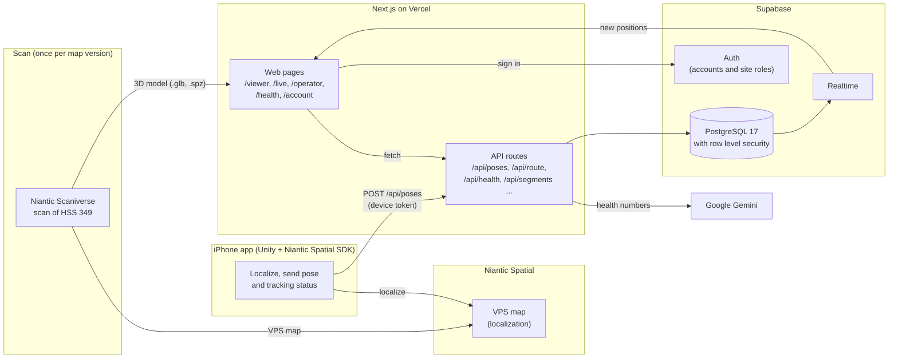
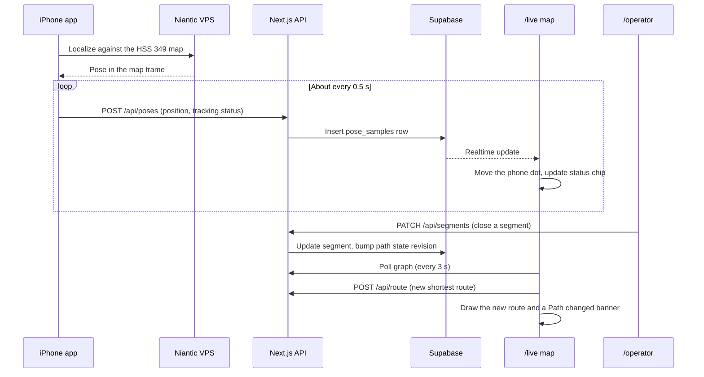
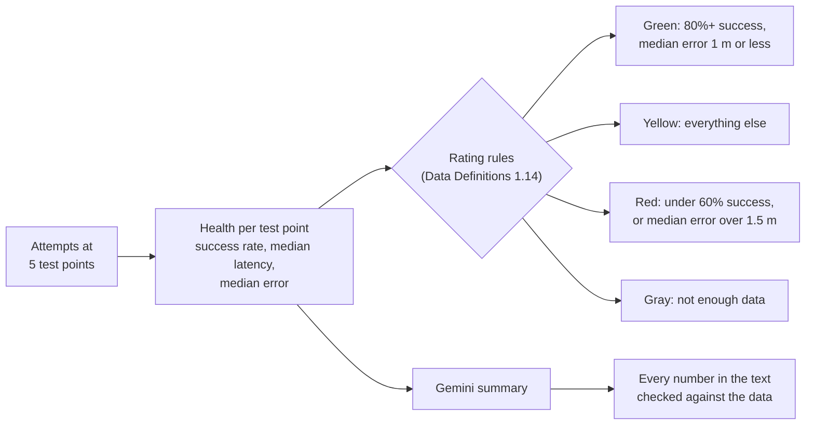
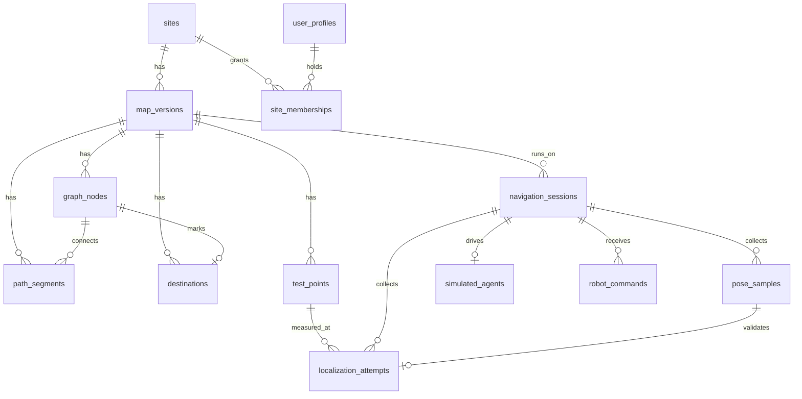
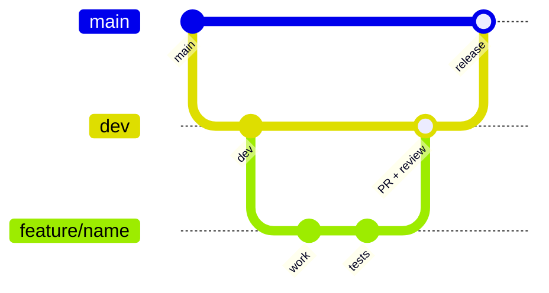

# SpatialOS

**Shared Spatial Operations and Localization Reliability**

CSC 648/848 Software Engineering · San Francisco State University · Section 06, Team 02 · Fall 2026

[](https://github.com/ezerenm/SFSU-csc648-06-Fall26-team02/actions/workflows/ci.yml)
[](LICENSE)
[](https://sfsu-csc648-06-fall26-team02.vercel.app)

| | |
|---|---|
| **Live site** | <https://sfsu-csc648-06-fall26-team02.vercel.app> |
| **API docs (TypeDoc)** | <https://sfsu-csc648-06-fall26-team02.vercel.app/api-docs/index.html> |
| **Task board** | <https://github.com/users/tduong64/projects/1> |
| **Bug tracker** | [GitHub Issues, label `bug`](https://github.com/ezerenm/SFSU-csc648-06-Fall26-team02/issues?q=is%3Aissue%20label%3Abug) |
| **Current milestone** | [M5: Final delivery and Demo Day, December 8, 2026](milestones/M5) |

---

## Contents

1. [What SpatialOS is](#what-spatialos-is)
2. [Key concepts](#key-concepts)
3. [How it works](#how-it-works)
4. [Who uses it](#who-uses-it)
5. [Features](#features)
6. [Project status](#project-status)
7. [Pages and APIs](#pages-and-apis)
8. [Tech stack](#tech-stack)
9. [Repository layout](#repository-layout)
10. [Getting started](#getting-started)
11. [Testing and code quality](#testing-and-code-quality)
12. [Database](#database)
13. [Git workflow](#git-workflow)
14. [Deployment](#deployment)
15. [Milestones](#milestones)
16. [Team](#team)
17. [License](#license)

---

## What SpatialOS is

Indoor robots and indoor navigation apps depend on one thing: **knowing exactly where the device is**. GPS does not work well inside buildings, so phones and robots use visual positioning instead. They compare what the camera sees with a 3D scan of the room. That works well in some spots and badly in others (near blank walls, in poor light, in crowded areas), and site operators usually have no way to see where it fails.

SpatialOS is a web platform that answers that question for one real SFSU room, **HSS 349**:

- **Shared map.** The room is scanned with Niantic Scaniverse. The scan becomes both a 3D model in the browser and a Niantic VPS (Visual Positioning System) map that iPhones localize against.
- **Live position.** An iPhone app localizes with Niantic VPS and streams its position and tracking status to a live web map twice per second.
- **Shared routes.** People and a **simulated robot** share one route graph. A real iPhone acts as the robot proxy; there is no physical robot. Each gets the shortest route it is allowed to take, and routes are recalculated live when an operator closes a path or restricts it to humans.
- **Localization reliability.** Localization attempts are recorded at fixed **test points**. Each test point gets a green, yellow, red or gray health rating, and **Gemini** writes a plain-language summary in which every number is checked against the data.

After the M3 review the main focus of the project is **localization data and accuracy**. Navigation is the tool that drives the data collection runs.

## Key concepts

| Term | Meaning |
|---|---|
| **Site** | A real place we scanned. The demo site is SFSU HSS 349. |
| **Map version** | One scan of a site (current: `HSS349-v3`). Everything else is stored against a map version. |
| **Graph node** | A named point on the map, for example *Door* or *Front of Room*. |
| **Path segment** | A walkable connection between two nodes. Each has an **availability** (open or closed) and a **robot access** (allowed or humans only). |
| **Destination** | A node a person or the simulated robot can be routed to. |
| **Route** | The shortest path over the segments a person or the robot may use, computed with our own Dijkstra implementation. |
| **Pose sample** | One position and tracking status sent by the phone (about every 0.5 s). |
| **Test point** | A marked spot in the room where localization is tested (5 in HSS 349). |
| **Localization attempt** | One try to localize at a test point: success or a failure type (timeout, tracking loss, map mismatch, and so on), latency, and measured error in meters. |
| **Run** | A data collection session for one phone on one map; poses and attempts inside its time window are linked to it. |
| **Health** | The rating of one test point from its attempts: success rate, median latency and median error. |

## How it works

### System architecture



### Live position and rerouting



### Localization health and AI summary



## Who uses it

Every account gets one role per site. A new sign-up is a **visitor** on the HSS 349 demo site; an administrator can change it.

| Role | Can do |
|---|---|
| **Anyone (not signed in)** | View the 3D scan, the live map, routes, health and the data lists of the public demo map |
| **Visitor** | Everything above, signed in |
| **Developer** | Start and stop data collection runs |
| **Operator** | Start and stop runs; close, reopen and restrict path segments for the robot |
| **Administrator** | Everything an operator can do, plus assign roles to other accounts |

## Features

| Area | What it does | Requirements |
|---|---|---|
| Accounts and roles | Sign up, sign in, one role per site, administrator role manager | R1.1 to R1.4 |
| 3D view | Gaussian splat of the scanned room with nodes, segments, destinations and routes | R2.1 to R2.4 |
| Live position | Phone pose and tracking status on the live map; stale after 5 s, "Timed out, try again" after 30 s | R3.2 to R3.4, R4.1, R4.2, R19 |
| Routing | Shortest route for a person or the simulated robot; live start snaps to the nearest open path within 2 m | R5.1 to R5.4, R6.1 to R6.4 |
| Operator controls | Close, reopen, set humans only, allow robots; changes show on every open map within seconds | R8.1 to R8.3, R17.1, R17.2 |
| Rerouting | Routes are recalculated when a segment on them changes; "Unreachable" when no permitted route exists | R9.1 to R9.3 |
| Simulated robot | A robot proxy phone shown in orange, with its own route on robot-allowed segments | R10.1 to R10.3, R5.6 |
| Data collection | Runs, live attempt logging with measured error, capture indicator, failure list | R11.1, R12.1 to R12.4 |
| Localization health | Per test point rating with success rate, latency and error | R14.1 to R14.5 |
| Search | List and search attempts, destinations and path segments | R15.1, R15.3 |
| AI summary | Gemini explains the health results; every number is verified | R16.1 |

The full frozen Priority 1 list (51 items) is in [M3 Appendix I](milestones/M3).

## Project status

As of release #117 (November 22, 2026), from the [M4 report](milestones/M4):

| Measure | Result |
|---|---|
| Unit tests | **184 passing** (171 Node test runner, 13 Vitest) |
| Coverage | **95.55% lines**, 93.85% functions, 92.67% statements |
| Integration tests | 37 of 38 cases run, **0 failures** |
| Priority 1 features exercised | **48 of 51 (94.1%)**: 42 full, 6 partial |
| Bugs logged and closed | 21, each linked to its fix commit |
| Public functions documented | 64 of 75 (85.3%), published as HTML |

**Next (M5):** localization data at all 5 test points, health charts, the operator failure page, and the robot mode on the phone. See the [M5 plan](milestones/M5).

## Pages and APIs

| Page | What it shows | Access |
|---|---|---|
| `/` | Home: list and search localization attempts, destinations and path segments | Public |
| `/viewer` | 3D scan with nodes, segments, destinations, routes and phones | Public |
| `/live` | Live map: phones with status chips, visitor and simulated robot routes, rerouting, capture status | Public |
| `/health` | Health per test point and **Explain with AI** | Public |
| `/account` | Sign up, sign in, your site roles; role manager for administrators | Signed in |
| `/operator` | Live map plus Close, Reopen, Humans only and Allow robots for each segment | Operator or administrator |
| `/api-docs` | Generated TypeDoc reference for `lib/routing` and `lib/spatial` | Public |
| `/about`, `/about/<name>` | Team pages | Public |

| Method and path | Purpose | Auth |
|---|---|---|
| `GET /api/graph?map_version_id=<uuid>` | Nodes, segments, destinations and test points of a public map | None |
| `POST /api/route` | Shortest route (Dijkstra) for the human or robot profile | None |
| `POST /api/poses` | Phone pose and tracking status upload | `x-device-token` |
| `GET /api/localization-attempts?map_version_id=<uuid>` | Attempt list and search with test point and outcome filters | None |
| `POST /api/localization-attempts` | Live attempt from the phone; idempotent by attempt ID | `x-device-token` |
| `GET /api/failures?map_version_id=<uuid>` | Failure list with optional `failure_type` filter | None |
| `POST /api/runs` | Start a data collection run (201, or 409 if one is active) | Bearer token (developer, operator, administrator) |
| `PATCH /api/runs` | Stop a run | Bearer token |
| `GET /api/runs/counts?run_id=<uuid>` | Samples, attempts and failures in a run | None |
| `GET /api/health?map_version_id=<uuid>` | Health per test point and device | None |
| `POST /api/health/summary` | Gemini summary of the health results, numbers checked | None |
| `PATCH /api/segments` | Change a segment (409 on a conflicting change) | Bearer token (operator, administrator) |
| `GET /api/team` | Team data | None |

Request and response details are in the [M2 contracts](milestones/M2/CONTRACTS.md), the [M4 notes](milestones/M4) and the [API docs](https://sfsu-csc648-06-fall26-team02.vercel.app/api-docs/index.html).

## Tech stack

| Layer | Technology |
|---|---|
| Hosting | Vercel (Hobby tier), serverless functions on Node.js 22 |
| Web app | Next.js 16 (App Router), React 19, TypeScript (strict), Tailwind CSS 4 |
| 3D | Three.js, Spark (Gaussian splats), GLB model of the scan |
| Database | Supabase PostgreSQL 17 with row level security, Supabase Realtime |
| Auth | Supabase Auth with per-site roles |
| Routing | Team-written Dijkstra with a binary min-heap (`lib/routing`) |
| AI | Google Gemini API (`gemini-flash-lite-latest` by default) |
| Phone app | Unity 6000.3.14f1 + Niantic Spatial SDK 4.1.0 (iPhone) |
| Scanning and localization | Niantic Scaniverse, Niantic VPS |
| Tests | Node.js test runner, Vitest, SQL tests on PostgreSQL |
| Quality | ESLint 9 (TypeScript-ESLint, Next.js rules), GitHub Actions CI, TypeDoc |

## Repository layout

```
SFSU-csc648-06-Fall26-team02/
├── app/
│   ├── frontend/                Next.js web app and API
│   │   ├── app/                 Pages and API routes (app/api/*)
│   │   ├── components/          UI by page: viewer, live, operator, health, account, home
│   │   ├── lib/routing/         Dijkstra route engine (Vitest)
│   │   ├── lib/spatial/         Domain logic: health, segments, live start, robot, runs
│   │   ├── lib/spatial/server/  Server only: Supabase adapter, Gemini, validation, auth
│   │   ├── tests/               Node unit tests
│   │   └── public/models/       HSS 349 scan (.glb, .spz)
│   ├── backend/
│   │   ├── schema.sql           M0 baseline
│   │   ├── migrations/          Ordered, apply-once schema changes
│   │   └── tests/               SQL tests (run in a transaction, roll back)
│   └── phone/                   Unity iPhone client (see app/phone/README.md)
├── milestones/                  M0 to M5 documents and notes
├── .github/workflows/
│   ├── ci.yml                   Lint, typecheck and tests on every PR
│   └── keep-supabase-alive.yml  Daily ping so the free Supabase project stays awake
└── LICENSE
```

## Getting started

### Prerequisites

- Node.js 22 (matches Vercel; 20.9 is the minimum for Next.js 16)
- Access to the team Supabase project (ask a teammate for the keys)
- For the phone app only: a Mac with Xcode, Unity 6000.3.14f1 and an iPhone. See [app/phone/README.md](app/phone/README.md).

### Run the web app

```bash
git clone https://github.com/ezerenm/SFSU-csc648-06-Fall26-team02.git
cd SFSU-csc648-06-Fall26-team02/app/frontend
npm ci
```

Create `app/frontend/.env.local`. It is ignored by Git; never commit it.

```dotenv
NEXT_PUBLIC_SUPABASE_URL=<project url>
NEXT_PUBLIC_SUPABASE_ANON_KEY=<publishable key>
```

These two are enough for the public pages. Add the others only for the feature you work on:

| Variable | Needed for |
|---|---|
| `SUPABASE_URL`, `SUPABASE_SERVICE_ROLE_KEY` | Server-only phone writes (poses, attempts) |
| `DEVICE_TOKEN` | Phone uploads to `/api/poses` and `/api/localization-attempts` |
| `GEMINI_API_KEY`, optional `GEMINI_MODEL` | The AI summary on `/health` |

Never put the service role key in a `NEXT_PUBLIC_` variable.

```bash
npm run dev    # http://localhost:3000
```

## Testing and code quality

From `app/frontend`:

| Command | What it does |
|---|---|
| `npm test` | Node unit tests, then the Vitest routing tests |
| `npm run test:coverage` | Unit tests with line, branch and function coverage |
| `npm run lint` | ESLint (TypeScript-ESLint and Next.js rules) |
| `npm run typecheck` | TypeScript strict type check |
| `npm run docs` | TypeDoc HTML into `public/api-docs` (not committed) |
| `npm run build` | TypeDoc, then the production build |

Tests never call Supabase or Gemini; they use fixtures and fake callers. SQL tests in `app/backend/tests/` run against a disposable PostgreSQL database after the migrations.

**CI:** [`ci.yml`](.github/workflows/ci.yml) runs `npm ci`, ESLint, typecheck and all tests on every pull request into `dev` or `main` and on every push to `dev`. A failing step turns the check red, and the pull request is not merged until it is green.

## Database

Supabase PostgreSQL 17 with row level security on every table. Schema changes are ordered, apply-once files in [`app/backend/migrations/`](app/backend/migrations), each applied to the shared project by hand, once, after review.



| Added in | Tables |
|---|---|
| M0 | `users`, `team_members`, `keepalive` |
| M2 | `sites`, `map_versions`, `graph_nodes`, `path_segments`, `destinations`, `test_points`, `localization_attempts`, `pose_samples` |
| M3 | `navigation_sessions`, `simulated_agents`, `robot_commands` |
| M4 | `user_profiles`, `site_memberships`; live attempt ingestion and run linking |

## Git workflow



| Branch | Purpose |
|---|---|
| `main` | Production. Auto-deploys to Vercel. No direct pushes. |
| `dev` | Integration. Every pull request targets `dev`. |
| `feature/<name>` | New work, for example `feature/sumit-health-page` |
| `fix/<name>`, `docs/<name>`, `chore/<name>` | Bug fixes, documentation, configuration |

1. `git checkout dev && git pull`
2. `git checkout -b feature/<name>`
3. Commit and push, then open a pull request **into `dev`**. Put the requirement IDs in the title and a "How to review" section in the description.
4. CI must be green. Get two reviews, then merge with a regular merge commit. Delete the feature branch after merging; never delete `dev`.
5. `dev` is merged into `main` for each release.

Bugs are logged as GitHub Issues with the `bug` label, an assignee, the cause and a link to the fix commit.

Never commit `.env.local`, keys, tokens or personal information (student IDs, personal emails). This repository is public.

## Deployment

- Every push to `main` triggers a Vercel production deploy. `npm run build` also regenerates the API docs.
- Pull requests get a Vercel preview build. On the Hobby plan only the project owner can open preview links, so reviewers test locally.
- Environment variables are set in Vercel under Settings, Environment Variables, and take effect on the next deploy.
- The Supabase free tier pauses a project after about 7 idle days. [`keep-supabase-alive.yml`](.github/workflows/keep-supabase-alive.yml) pings it daily.

## Milestones

| Milestone | Date | Contents |
|---|---|---|
| [M0](milestones/M0) | Sep 15, 2026 | Team setup, technology stack, first deployed pages |
| [M1](milestones/M1) | Sep 29, 2026 | Personas, user stories, requirements, competitive analysis |
| [M2](milestones/M2) | Oct 20, 2026 | Data definitions, architecture, UML, vertical prototype |
| [M3](milestones/M3) | Nov 3 to 4, 2026 | Demo, frozen Priority 1 list, Appendix I |
| [M4](milestones/M4) | Nov 22, 2026 | QA testing and coding practices |
| [M5](milestones/M5) | Dec 8, 2026 | Final delivery and Demo Day |

## Team

| Name | Role | GitHub |
|---|---|---|
| Daksh Kumar | Team Lead | [@Dakshkumar24](https://github.com/Dakshkumar24) |
| Calvin Mei | Front-End Lead | [@Kaolinium](https://github.com/Kaolinium) |
| Noah Bran | Back-End Lead | [@NoahBran8](https://github.com/NoahBran8) |
| Sumit Kumar | AI Master | [@Sumitkumar06](https://github.com/Sumitkumar06) |
| Tyler Duong | Scrum Master | [@tduong64](https://github.com/tduong64) |
| Ezeren Masangcay | GitHub Master | [@ezerenm](https://github.com/ezerenm) |

Instructor: Prof. Isabel Hyo Jung Song · TA: Jared Aung

## License

Licensed under the [Apache License 2.0](LICENSE).
