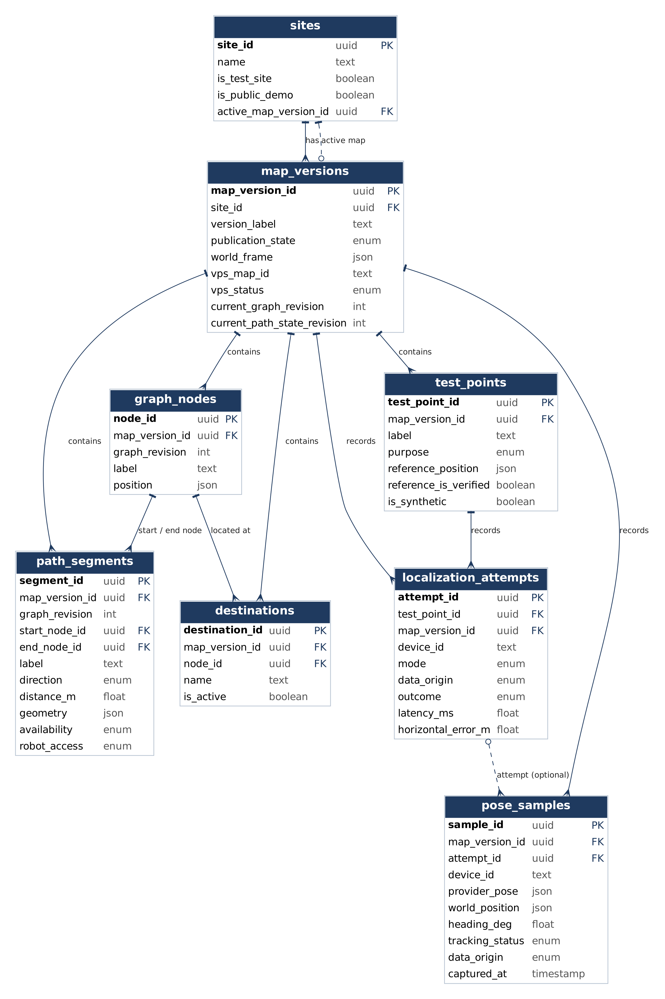

# 1. Data Definitions V2

This section expands the M1 data definitions into full field-level definitions. The same names are used in the database, the API JSON, the TypeScript types (`lib/spatial/contracts.ts`), the UML in Section 5 and the UI. Each entity is tagged **[M2]** if it is built and used in the M2 prototype, **[M2 partial]** if only part of it is built, or **[Planned]** if it is built in M3 to M5. Planned entities are still fully defined here because they are part of the full design.

## 1.1 Conventions

| Convention | Definition |
|---|---|
| Naming | `snake_case` in SQL and API JSON. Table names are plural (`graph_nodes`); entity names in the UML are singular (GraphNode). |
| Terms | A **path segment** is a walkable connection between two **graph nodes**. The requirements list (Section 2) calls a path segment an *edge*. |
| IDs | UUID. Every reference points to an existing record. |
| Time | `timestamptz` (UTC), ISO 8601 in the API. Displayed in local time. |
| Units | Positions and distances in meters, latency in milliseconds, heading in degrees. Distances are stored to the millimeter and shown with one decimal (5.1 m). |
| Missing data | `null`, never 0. A missing latency, pose or error is never stored as zero. |
| Enums | Fixed value lists; unknown values are rejected by the database and the API. Exception: pose `data_origin` is not taken from the client as is. The server sets it to `synthetic` for the fake-test device or when the client sends `synthetic`, and to `real` otherwise (1.10). |
| Text limits | Names and labels 120 characters; descriptions and reasons 1,000 characters. |
| Map scope | Every spatial record belongs to one map version; linked records must share it and its graph revision. |

**Shared values**

| Value | Definition |
|---|---|
| `position` | `{x_m, y_m, z_m}` in world meters. |
| `orientation` | Quaternion `{x, y, z, w}`. Expected to be normalized; in M2 the API checks only that the four values are numbers, and normalization checks follow in M3. |
| `world_frame` | Object `{frame_id, origin_description, handedness: "right", up_axis: "y", units: "meters"}`. Right-handed, Y up, X and Z horizontal. Stored on each map version. |
| `provider_pose` | Raw phone pose as reported by the Niantic SDK in Unity: `{position: {x, y, z}, rotation: {x, y, z, w}}`. |
| `route_step` | `{segment_id, from_node_id, to_node_id}` (UUIDs); gives the travel direction explicitly. |

**How coordinates line up**

| Data | Frame | How it gets into the world frame |
|---|---|---|
| World frame (HSS 349) | VPS map frame of *SFSU HSS 349 v2* | This is the world frame of the HSS 349 map version. |
| Scanned 3D model (GLB) | Same VPS map frame | Exported from the VPS map, so no conversion is needed (identity). |
| Graph nodes, destinations | World frame | Recorded on site with the iPhone while localized on the same VPS map. `y_m = 0` is phone height; the viewer draws the graph at the floor height measured in the scan (−1.29 m). |
| Test points | World frame | The location is picked on the model. The reference position used to measure accuracy is measured independently on site, not taken from the model (1.8). |
| iPhone pose from VPS | Unity coordinates (left-handed) of the same VPS map | Converted by the server: world = (x, y, −z). From M3, a map whose model and VPS frame differ uses a verified `frame_transforms` row (1.12). |

## 1.2 Users, roles and privileges

**[Planned] Application roles.** The roles from M1 are kept. Accounts and passwords are managed by Supabase Auth and never stored in application tables. Permissions are enforced by the API (RoleGuard, Section 5) and by database row-level security, never by the UI alone.

| Role | Can do |
|---|---|
| `visitor` | View the environment and destinations; navigate; see own session, pose and route. |
| `developer` | Visitor abilities, plus run localization attempts and labeled simulation or replay, and view site evaluation results. |
| `operator` | Visitor abilities, plus edit destinations and path segments, open or close segments, set robot access, and review agent reports. |
| `administrator` | Manage accounts, site memberships, site configuration and map publication. |

**[M2] Access in the prototype.** M2 has no sign-in yet. Access is limited as follows:

| Actor | Can do in M2 |
|---|---|
| Anyone with the site URL | Through the API: read the published public demo maps (`sites.is_public_demo`), their graph, destinations and synthetic attempts, and request routes. Directly from Supabase (anon key): read pose samples. No writes. The current pose read policy allows reading every pose; limiting it to public demo maps is planned for M3. |
| iPhone app with the device token | Add pose samples through POST /api/poses. The token is a server-side environment variable (`DEVICE_TOKEN`), never stored in a table. |
| Team, TA and instructor (Supabase project members) | Full table access in the Supabase dashboard, for seeding and migrations. |

**user_profiles [Planned]**

| Field | Type | Notes |
|---|---|---|
| `user_id` | UUID | Same as the Supabase Auth user ID |
| `display_name` | text | Shown in the app, max 120 characters |
| `created_at` | timestamp | When the profile was created |

**site_memberships [Planned]**

| Field | Type | Notes |
|---|---|---|
| `membership_id` | UUID | Primary key |
| `user_id` | UUID | Links to `user_profiles` |
| `site_id` | UUID | Site the role applies to |
| `role` | enum | `visitor`, `developer`, `operator`, `administrator`; one active role per user per site |
| `is_active` | boolean | False = access removed |
| `created_at` | timestamp | When the membership was granted |

## 1.3 Site [M2]

`sites`: a physical area. M2 has two published public demo sites:

- **SFSU HSS 349**: the real scanned classroom used for the 3D viewer, routing and live position.
- **SYNTHETIC M2 demo**: invented coordinates and labeled sample attempts for the list and search prototype (`is_test_site = true`). It is not a campus scan.

| Field | Type | Notes |
|---|---|---|
| `site_id` | UUID | Primary key |
| `name` | text | e.g. "SFSU HSS 349" |
| `description` | text | Area covered |
| `is_test_site` | boolean | `true` for seeded test data |
| `is_public_demo` | boolean | `true` = readable without sign-in in M2 |
| `active_map_version_id` | UUID, nullable | Published map used by default |
| `created_at`, `updated_at` | timestamp | Set by the database on insert and update |

## 1.4 Map version [M2]

`map_versions`: one captured version of a site.

| Field | Type | Notes |
|---|---|---|
| `map_version_id` | UUID | Primary key |
| `site_id` | UUID | Owning site |
| `version_label` | text | Unique per site, e.g. "HSS349-v1" |
| `publication_state` | enum | `draft`, `published`, `retired`; published requires `published_at` |
| `world_frame` | object | See 1.1 |
| `visual_asset_id` | UUID, nullable | Displayed 3D model (1.12). Null in M2; the viewer loads the model file directly. |
| `vps_map_id` | text, nullable | Niantic localization map ID; separate from the visual asset |
| `vps_status` | enum | `not_configured`, `draft`, `production`, `unavailable`; draft and production require `vps_map_id` |
| `current_graph_revision` | integer | Topology version |
| `current_path_state_revision` | integer | Open/closed and robot-access version |
| `captured_at`, `published_at` | timestamp, nullable | When the area was scanned and when this version was published; published requires `published_at` |

The visual model is what users see; the VPS map is what the phone localizes against. They are stored separately. For HSS 349 they share one frame (1.1); other maps are aligned through a frame transform from M3 (1.12).

## 1.5 Graph nodes [M2]

`graph_nodes`: waypoints that path segments and destinations connect to.

| Field | Type | Notes |
|---|---|---|
| `node_id` | UUID | Primary key; referenced by path segments and destinations |
| `map_version_id` | UUID | Map version the node belongs to |
| `graph_revision` | integer | Graph revision the node belongs to; must match the map's current revision to be shown |
| `label` | text | e.g. "N1 Door" |
| `position` | position | World meters |

HSS 349 has four nodes: N1 Door, N2 Back corner (door side), N3 Back corner (far) and N4 Front of room. The UI shows each node by the name of its destination (1.7).

## 1.6 Path segments [M2]

`path_segments`: walkable connections between two nodes.

| Field | Type | Notes |
|---|---|---|
| `segment_id` | UUID | Primary key; referenced by route steps |
| `map_version_id`, `graph_revision` | UUID, integer | Same revision as both endpoints |
| `label` | text | Searchable, e.g. "Front to Door" |
| `start_node_id`, `end_node_id` | UUID | Different nodes |
| `direction` | enum | `bidirectional`, `start_to_end` |
| `distance_m` | number | Positive; must match the geometry length within 0.01 m |
| `geometry` | array of position | 2 to 1,000 points; first and last point equal the start and end node positions |
| `availability` | enum | `open`, `closed` |
| `robot_access` | enum | `allowed`, `restricted` |
| `last_state_revision` | integer | Path-state revision of the last open/closed or robot-access change |
| `updated_at` | timestamp | Set by the database on every update |

A human route may use any **open** segment. A robot route may use only segments that are **open and robot-allowed**. Reopening a segment keeps its robot access rule. The database rejects a segment whose geometry or distance does not match its nodes.

## 1.7 Destinations [M2]

`destinations`: named places users can navigate to. HSS 349 has four, one at each node: **Door, Back Corner (Door Side), Back Corner (Far Side)** and **Front of Room**. The synthetic demo map has three (Room 103, Lobby, East room).

| Field | Type | Notes |
|---|---|---|
| `destination_id` | UUID | Primary key; sent in route requests |
| `site_id`, `map_version_id` | UUID | Site and map version the destination belongs to; must match its node |
| `graph_revision` | integer | Same revision as its node |
| `node_id` | UUID | Destination node in the same graph |
| `name` | text | Searchable; shown in the Start and Destination lists |
| `description` | text | Short explanation shown with the name, e.g. "Room entrance" |
| `is_active` | boolean | Offered for new navigation |
| `updated_at` | timestamp | Set by the database on every update |

## 1.8 Test points [M2]

`test_points`: fixed physical camera positions used to evaluate localization. The full design has five evaluation points per site; points used for alignment are kept separate. In M2 the five test points belong to the synthetic demo map (`is_synthetic = true`) and are used only for the attempt search.

| Field | Type | Notes |
|---|---|---|
| `test_point_id` | UUID | Primary key; used as a search filter |
| `map_version_id` | UUID | Map version the test point belongs to |
| `label` | text | Searchable, unique per map, e.g. "TP3 lobby" |
| `purpose` | enum | `evaluation`, `alignment` |
| `reference_position` | position, nullable | Camera position measured independently on site (not taken from the model) |
| `reference_method` | text, nullable | How it was measured |
| `reference_uncertainty_m` | number, nullable | Never assumed 0 |
| `reference_is_verified` | boolean | Only verified points count toward error; requires a real point with position, method and uncertainty |
| `is_synthetic` | boolean | `true` for seeded test data |

## 1.9 Localization attempts [M2]

`localization_attempts`: one record per started localization attempt, including every failure and timeout. **Success** means a valid pose for the intended map within 30 seconds; accuracy is measured separately.

| Field | Type | Notes |
|---|---|---|
| `attempt_id` | UUID | Resending the same attempt keeps its ID; a new attempt gets a new ID |
| `session_id` | UUID, nullable | Links to a session from M3; null in M2 |
| `map_version_id`, `test_point_id` | UUID | Map and test point of the attempt; the test point must belong to the map |
| `device_id` | text | Pseudonymous device label |
| `sdk_version` | text, nullable | Required for live attempts; null for synthetic data |
| `mode` | enum | `live`, `simulation`, `replay` |
| `data_origin` | enum | `live_sdk`, `synthetic`, `recorded` (pairs with mode: live/live_sdk, simulation/synthetic, replay/recorded) |
| `condition_label` | text | e.g. "daylight", "evening" |
| `camera_direction` | text | e.g. "facing north" |
| `started_at`, `ended_at` | timestamp | `ended_at` is null while in progress |
| `outcome` | enum | `in_progress`, `success`, `timeout`, `tracking_loss`, `network_error`, `map_mismatch`, `cancelled`, `other_failure` |
| `latency_ms` | number, nullable | Success only, 0 to 30,000 |
| `failure_reason` | text, nullable | Required for failures |
| `valid_pose_sample_id` | UUID, nullable | Required for a live success from M3; null in M2 |
| `horizontal_error_m` | number, nullable | X/Z distance to a verified reference; null in M2 |
| `error_is_valid` | boolean | False for synthetic data and in M2 |
| `received_at` | timestamp | Server receipt time |

Horizontal error = √((pose.x − ref.x)² + (pose.z − ref.z)²). In M2 all attempts are labeled synthetic samples (`mode = simulation`), and the database itself keeps the M3 fields empty, so no sample can be mistaken for a measured result. Synthetic and replayed attempts never count as live evidence.

## 1.10 Pose samples [M2 partial] and sessions [Planned]

A **pose sample** is one position report from the phone. It is built in M2: the iPhone app sends one every 0.5 s and the /live page shows the latest one as a moving dot. A **session** groups one device's live, simulation or replay data from M3.

**pose_samples [M2 partial]**

| Field | Type | Notes |
|---|---|---|
| `sample_id` | UUID | Created by the phone; sending the same ID again stores nothing new |
| `map_version_id` | UUID | Map the pose belongs to; must be published |
| `attempt_id` | UUID, nullable | Localization attempt the pose belongs to, if any |
| `device_id` | text | Pseudonymous device label, 1 to 120 characters; "fake-test" for pipeline tests |
| `provider_map_id` | text, nullable | VPS map the phone localized against; must match `vps_map_id` when both are set |
| `provider_pose` | provider_pose | Raw pose from the phone (1.1) |
| `world_position` | position, nullable | Converted by the server: (x, y, −z) |
| `heading_deg` | number, nullable | 0 to 360; 0 = world +Z, increasing toward world +X |
| `tracking_status` | enum | `localizing`, `valid`, `lost` |
| `data_origin` | enum | `real`, `synthetic`; decided by the server: synthetic for the fake-test device or when the client sends synthetic, otherwise real |
| `captured_at` | timestamp | Time on the phone; at most 1 minute in the future |
| `received_at` | timestamp | Time on the server |
| `session_id`, `transform_id`, `world_orientation` | UUID, UUID, orientation | Planned for M3 |

A pose is **live** when its tracking is `valid` and it is less than 5 seconds old; otherwise /live shows it as “Not live”. Synthetic poses are labeled “test pose” on /live but, in M2, still drive the live dot and route. From M3, stale, lost and synthetic poses cannot start a new live route.

**navigation_sessions [Planned]**

| Field | Type | Notes |
|---|---|---|
| `session_id` | UUID | Primary key |
| `user_id` | UUID, nullable | Null only for seeded test sessions |
| `site_id`, `map_version_id` | UUID | Map is fixed for the whole session |
| `device_id` | text | Pseudonymous device label |
| `device_model` | text | e.g. "iPhone 17 Pro"; "synthetic" for test data |
| `sdk_version` | text, nullable | Niantic SDK version used |
| `mode` | enum | `live`, `simulation`, `replay` |
| `data_origin` | enum | `live_sdk`, `synthetic`, `recorded` |
| `status` | enum | `active`, `ended`, `failed` |
| `started_at` | timestamp | When the session started |
| `ended_at` | timestamp, nullable | Null while active |

## 1.11 Routes [M2 partial] and simulated agent [Planned]

**In M2**, POST /api/route computes a route from a start node to a destination, for a person or the simulated robot, and returns it without storing it. **From M3**, routes are stored in `routes` so they can be invalidated and replanned.

| Field | Type | Notes |
|---|---|---|
| `route_id` | UUID | M3+ (stored routes only) |
| `session_id` | UUID, nullable | M3+ |
| `map_version_id` | UUID | Map the route was computed on |
| `graph_revision`, `path_state_revision` | integer | Graph and open/closed state used |
| `start_mode` | enum | `manual` in M2; `live` from M3 |
| `start_node_id` | UUID | M2: chosen by hand on /viewer, or the node nearest the phone on /live |
| `start_position` | position, nullable | M3+: live position used as the start |
| `start_segment_id` | UUID, nullable | M3+: walkable segment the live start is attached to |
| `destination_id` | UUID | Destination requested; resolved to its node by the API |
| `profile` | enum | `human`, `robot` |
| `steps` | array of route_step | Ordered path; empty when unreachable or when start = destination |
| `total_distance_m` | number, nullable | 0 when start = destination; null if unreachable |
| `status` | enum | `valid`, `unreachable` (M2); `invalidated`, `arrived` (M3+) |
| `created_at` | timestamp | When the route was computed (server time) |

**simulated_agents [Planned]**

| Field | Type | Notes |
|---|---|---|
| `agent_id` | UUID | Primary key |
| `session_id` | UUID | Simulation-mode session only |
| `route_id` | UUID, nullable | Current route |
| `position` | position | Current position on its path |
| `current_step_index` | integer, nullable | Index into the route's steps |
| `step_progress_m` | number | Distance along the current step |
| `speed_mps` | number | Configured simulation speed (> 0) |
| `state` | enum | `idle`, `running`, `paused`, `waiting_for_operator`, `arrived`, `unreachable` |
| `updated_at` | timestamp | When the position or state last changed |

A live start (M3) is accepted only if it is within `max_start_distance_m` (a site setting, agreed after first tests) of a walkable segment on the same map version and the pose is live; otherwise it is rejected with an error. The robot is always labeled SIMULATED in the UI. When a segment's availability or robot access changes, affected routes are invalidated and replanned, or marked unreachable.

## 1.12 Visual assets [M2 partial] and alignment [Planned]

**In M2**, the HSS 349 model is a static GLB file served by Vercel (`public/models/hss349-v2.glb`, 4.9 MB, textures 2048 px WebP, reduced from the 14.5 MB export). No frame transform is needed because the model, the graph and the poses share the VPS frame (1.1). Both tables below are created in M3, when models move to Supabase Storage and more maps are added.

**visual_assets [Planned]**

| Field | Type | Notes |
|---|---|---|
| `asset_id` | UUID | Primary key |
| `map_version_id` | UUID | Map version the asset displays |
| `asset_kind` | enum | `mesh`, `preview_image` |
| `storage_path` | text | Supabase Storage key |
| `file_format` | enum | `glb`, `png`, `jpeg`, `webp` |
| `byte_size` | integer | Must be within the limits below |
| `checksum_sha256` | text | 64 hex characters |
| `license_reference` | text | Who captured it / permission source |
| `created_at` | timestamp | When the asset was uploaded |

**frame_transforms [Planned]**

| Field | Type | Notes |
|---|---|---|
| `transform_id` | UUID | Primary key |
| `map_version_id` | UUID | Map version the transform belongs to |
| `source_frame_id` | text | e.g. a VPS site frame |
| `target_frame_id` | text | The map's world frame |
| `matrix_4x4` | array of 16 numbers | Row-major source → world transform; must be invertible |
| `validation_status` | enum | `unverified`, `verified`, `rejected` |
| `verified_at` | timestamp, nullable | When the transform was checked; required when verified |
| `verification_notes` | text | Which known points were checked and the error found |

**Media formats and limits**

| Asset | Format | Max size |
|---|---|---|
| 3D mesh | GLB (textures JPEG or WebP, max 4096 px) | 100 MB per file; keep under 10 MB for phones |
| Images | PNG, JPEG, WebP | 10 MB |
| Video | Not stored | n/a |

Total spatial asset storage stays within the 1 GB budget from M1. Raw camera recordings are not stored. From M3, live navigation uses only `verified` transforms.

## 1.13 Path events, simulated obstacles and agent reports [Planned]

**path_events**

| Field | Type | Notes |
|---|---|---|
| `event_id` | UUID | Primary key |
| `map_version_id`, `segment_id` | UUID | Map version and segment that changed |
| `actor_user_id` | UUID | Operator or admin who made the change |
| `event_type` | enum | `availability_change`, `robot_access_change` |
| `old_value`, `new_value` | text | Must be valid values of that field and must differ |
| `reason` | text | Why the change was made, e.g. "wet floor"; required |
| `path_state_revision` | integer | New map-wide revision number |
| `source_report_id` | UUID, nullable | Agent report that caused it, if any |
| `committed_at` | timestamp | When the change was committed |

**agent_reports**

| Field | Type | Notes |
|---|---|---|
| `report_id` | UUID | Primary key |
| `agent_id`, `segment_id` | UUID | Robot that reported it and the blocked segment |
| `reason` | text | Tester-injected simulated obstacle, not real sensing |
| `status` | enum | `pending`, `confirmed`, `rejected` |
| `reported_at` | timestamp | When the robot sent the report |
| `reviewed_by_user_id` | UUID, nullable | Required once reviewed |
| `reviewed_at` | timestamp, nullable | When the operator decided; required once reviewed |
| `closure_event_id` | UUID, nullable | Required when confirmed |

**simulated_obstacles**

| Field | Type | Notes |
|---|---|---|
| `obstacle_id` | UUID | Primary key |
| `session_id` | UUID | Simulation session |
| `segment_id` | UUID | Segment the tester blocked |
| `placed_by_user_id` | UUID | Tester who placed it |
| `is_active` | boolean | Set false when dismissed |
| `placed_at` | timestamp | When the tester placed it |
| `dismissed_at` | timestamp, nullable | When it was dismissed; null while active |

When the robot reaches the node before a segment with an active obstacle, it stops (`waiting_for_operator`) and creates an agent report. **Confirm:** the segment closes and routes replan. **Reject:** the obstacle is dismissed (`is_active = false`) and the robot resumes if its route is still valid. A pending report never closes a path. Confirmation creates exactly one closure event; confirming twice creates no duplicate. Stale writes are rejected.

## 1.14 Metric snapshot and localization health [Planned]

**metric_snapshots**

| Field | Type | Notes |
|---|---|---|
| `snapshot_id` | UUID | Primary key |
| `test_point_id`, `map_version_id` | UUID | Health is per point, device and map |
| `device_id` | text | Device the health applies to |
| `attempt_ids` | array of UUID | Exact attempts used |
| `attempt_count` | integer | All completed live attempts, including failures; in_progress excluded |
| `success_count` | integer | Attempts with outcome success |
| `success_rate` | number, nullable | 0–1; null if no attempts |
| `median_latency_ms` | number, nullable | Successful attempts only |
| `valid_error_count` | integer | Attempts with a valid reference error |
| `median_horizontal_error_m` | number, nullable | Null if no valid errors |
| `health_status` | enum | `gray`, `red`, `yellow`, `green` |
| `calculated_at` | timestamp | When the snapshot was computed |

Health uses only **completed live** attempts (in_progress is excluded) from the same test point, device and map version. The rules are applied in order and the first match wins:

| Order | Status | Rule |
|---|---|---|
| 1 | Gray | Fewer than 10 attempts |
| 2 | Red | ≥10 attempts **and** success below 60% |
| 3 | Red | ≥10 attempts **and** ≥5 valid error samples **and** median error above 1.5 m |
| 4 | Gray | ≥10 attempts but fewer than 5 valid error samples |
| 5 | Green | ≥10 attempts, ≥5 valid error samples, success ≥80% **and** median error ≤1 m |
| 6 | Yellow | All other cases |

Counts are always shown with the status. Health describes tested positions only, not map freshness.

## 1.15 AI summaries and exports [Planned]

**ai_summaries**

| Field | Type | Notes |
|---|---|---|
| `summary_id` | UUID | Primary key |
| `snapshot_id` | UUID | Metrics the summary explains |
| `requested_by_user_id` | UUID | User who asked for the summary |
| `model_version`, `prompt_version` | text | Gemini model and prompt template used, for reproducibility |
| `status` | enum | `pending`, `completed`, `failed`, `timed_out` |
| `observations` | array of {text, metric_fields, attempt_ids} | Each claim cites its source |
| `suggestions` | array of text | Labeled separately from observations |
| `requested_at` | timestamp | When the summary was requested |
| `completed_at` | timestamp, nullable | When Gemini answered or the request failed; null while pending |

**attempt_exports**

| Field | Type | Notes |
|---|---|---|
| `export_id` | UUID | Primary key |
| `requested_by_user_id` | UUID | User who requested the export |
| `filters` | object | Test point, outcome, mode and date range used |
| `file_format` | enum | `csv`, `json` |
| `row_count` | integer | Number of attempts in the file |
| `generated_at` | timestamp | When the file was generated |

Gemini receives only aggregate metrics and attempt IDs, never camera data. All numbers are computed by the server; generated numbers that do not match the snapshot are rejected. The dashboard keeps working if Gemini fails (15-second timeout).

## 1.16 Relationships

- A **site** has map versions; a **map version** owns its graph nodes, path segments, destinations, test points, pose samples, assets and transforms.
- A **path segment** connects two graph nodes in the same graph revision; a **destination** points to one node.
- A **localization attempt** belongs to one test point and map version (and to a session from M3).
- A **pose sample** belongs to one map version and optionally to one attempt (and to a session from M3).
- A **route** uses ordered path segments from one graph revision and one path-state revision.
- An **agent report** targets one path segment; confirmation links it to one **path event**.
- A **metric snapshot** records the exact attempts it was computed from; an **AI summary** cites one snapshot.
- History is preserved: attempts, events and referenced map versions are retired, not deleted.

*Figure 1.1: M2 database tables (key fields)*

## 1.17 Traceability to requirements

| Data concept | Section | Requirements (Section 2) |
|---|---|---|
| Users, roles and privileges | 1.2 | R1.1–R1.4, R7.1–R7.3, R8.1–R8.2 |
| Site and map version | 1.3–1.4 | R2.1, R2.2 |
| Navigation graph | 1.5–1.6 | R2.3, R5.2, R5.4, R7.1, R7.2, R8.1–R8.3, R17.1, R17.2 |
| Destination | 1.7 | R2.4, R5.1, R7.3 |
| Test point and reference | 1.8 | R12.1, R14.3 |
| Localization attempt | 1.9 | R3.4, R12.1, R12.2, R14.1–R14.4, R15.1 |
| Pose sample and session | 1.10 | R3.2, R3.3, R4.1, R4.2, R6.2–R6.4, R11.1, R11.2 |
| Route and simulated agent | 1.11 | R5.1–R5.5, R6.1, R9.1–R9.3, R10.1–R10.5 |
| Visual asset and transform | 1.12 | R2.2, R3.3 |
| Path event, obstacle and report | 1.13 | R8.1–R8.3, R17.2, R18.1–R18.6 |
| Metric snapshot and health | 1.14 | R13.1, R13.2, R14.1–R14.5 |
| AI summary and export | 1.15 | R15.2, R16.1 |

