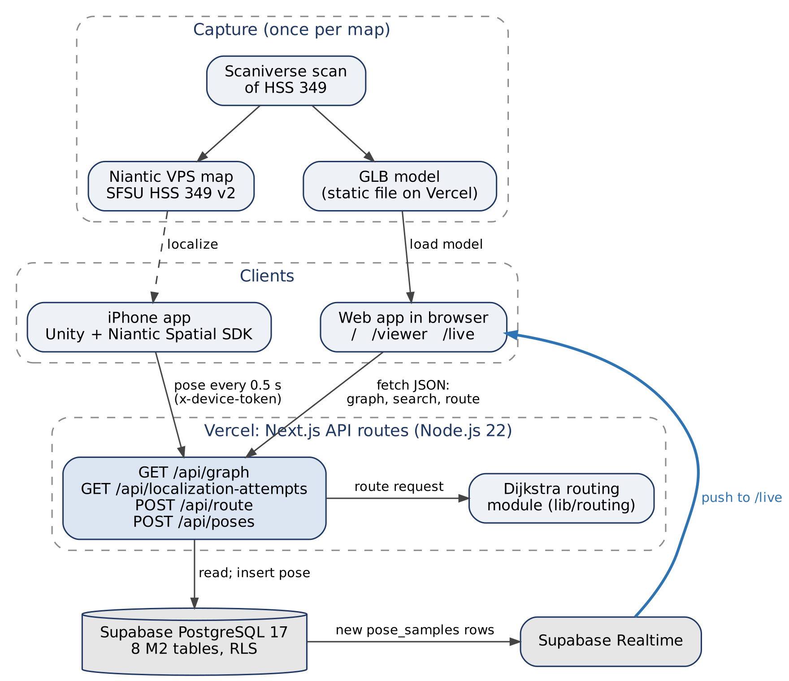

# 4. Architecture, Database and APIs

**Author:** Noah Bran, Backend Lead. **Reviewers:** Daksh Kumar, Ezeren Masangcay.
**Revision (Oct 20):** updated by Sumit Kumar to match the deployed code on `main` (89ad6c8) and Sections 1, 2 and 5.

**Status:** Built and deployed. The M2 schema, seed data and all four APIs run on production (`sfsu-csc648-06-fall26-team02.vercel.app`). Phone → production live position was verified in HSS 349 on Oct 20 (828 real poses stored in 8 sessions).

## 4.1 System architecture

SpatialOS has two clients that only talk to each other through our backend: the **Unity iPhone app** (localizes with Niantic VPS and sends its pose) and the **Next.js web app** (home page list/search, `/viewer` route planning on the 3D scan, `/live` navigation with the live phone dot). Supabase PostgreSQL 17 stores all data; Supabase Realtime pushes new poses to every open `/live` page.

*Figure 4.1: M2 system architecture. Diagram source: `diagrams/M2_Architecture.dot`.*

| Component | Technology | Role in M2 |
|---|---|---|
| iPhone app | Unity 6 (6000.3.14f1), C#, Niantic Spatial SDK 4.1, iOS | Localizes against the VPS map; `PoseReporter`/`PoseUploader` send the pose every 0.5 s while tracking is valid |
| Web app | Next.js 16 App Router, React 19, TypeScript, Tailwind, Three.js 0.186 | Home page list/search, `/viewer` (3D scan + graph + route), `/live` (2D map + live dot + route + arrival) |
| Backend | Next.js API routes on Vercel (Node.js 22) | Validation, routing, database access; no separate server |
| Routing | Team-written Dijkstra (`lib/routing`) | Shortest route for `human` or `robot` profile; unit tested with Vitest |
| Database | Supabase PostgreSQL 17 with row-level security | All structured data; Realtime publication on `pose_samples` |
| 3D model | Static GLB, `public/models/hss349-v2.glb` (4.9 MB) | Served by Vercel. Moves to Supabase Storage with the `visual_assets` table in M3 (Sections 1.12 and 5) |

**Spatial frame (no transform in M2).** The HSS 349 world frame is the VPS map frame of *SFSU HSS 349 v2*. The GLB is exported from the same map, and the graph nodes were recorded with the iPhone while localized on it, so model, graph and poses already share one frame. The only conversion is handedness: Unity is left-handed, our world frame is right-handed and Y-up, so `/api/poses` stores `world = (x, y, −z)`. The viewer draws the graph at the floor height measured in the scan (−1.29 m). A `frame_transforms` table is needed only for maps whose model and VPS frame differ; it is designed in Section 1.12 and planned for M3.

**Not built in M2** (designed, planned M3–M4): sign-in and roles, closures and rerouting, robot simulation, localization health and dashboard, Gemini summary, operator map editing.

## 4.2 Database organization

Migrations are in `app/backend/migrations/`: `202610110001_m2_foundation.sql` (7 tables), `pose_samples.sql`, `202610190001_hss349_four_destinations.sql`, `202610190002_pose_samples_data_origin.sql`, plus seeds `hss349_seed.sql` and `milestones/M2/seed.sql`. The M0 `users` and `team_members` tables are unchanged. Field-level definitions are in Section 1; table and field names here match it exactly.

| Table | Main columns | Relationships |
|---|---|---|
| `sites` | `site_id`, `name`, `description`, `is_test_site`, `is_public_demo`, `active_map_version_id` | Has many map versions |
| `map_versions` | `map_version_id`, `site_id`, `version_label`, `publication_state`, `world_frame`, `vps_map_id`, `vps_status`, `current_graph_revision`, `current_path_state_revision`, `published_at` | Owns nodes, segments, destinations, test points, attempts, pose samples |
| `graph_nodes` | `node_id`, `map_version_id`, `graph_revision`, `label`, `position {x_m,y_m,z_m}` | Endpoints of path segments; anchor of destinations |
| `path_segments` | `segment_id`, `map_version_id`, `label`, `start_node_id`, `end_node_id`, `geometry`, `distance_m`, `direction`, `availability` (open/closed), `robot_access` (allowed/restricted) | Two nodes on the same map and revision |
| `destinations` | `destination_id`, `site_id`, `map_version_id`, `graph_revision`, `node_id`, `name`, `description`, `is_active` | One node |
| `test_points` | `test_point_id`, `map_version_id`, `label`, `purpose`, `reference_position`, `reference_method`, `reference_uncertainty_m`, `reference_is_verified`, `is_synthetic` | Has many attempts |
| `localization_attempts` | `attempt_id`, `map_version_id`, `test_point_id`, `device_id`, `sdk_version`, `mode`, `data_origin`, `condition_label`, `camera_direction`, `started_at`, `ended_at`, `outcome`, `latency_ms`, `failure_reason`, `horizontal_error_m`, `error_is_valid` | One test point; may own pose samples |
| `pose_samples` | `sample_id`, `map_version_id`, `attempt_id`, `device_id`, `provider_map_id`, `provider_pose`, `world_position`, `heading_deg`, `tracking_status` (localizing/valid/lost), `data_origin` (real/synthetic), `captured_at`, `received_at` | One map version; optional attempt |

**Integrity rules enforced in the database.** UUID primary keys. Composite foreign keys keep nodes, segments and destinations on the same map and graph revision. Checks reject unknown enum values, empty labels, non-finite positions, self-loops, segment geometry that does not start/end at its nodes, `distance_m` that differs from the geometry length by more than 0.01 m, and inconsistent attempt timing (success within 30 s with latency ≤ elapsed time; timeout ≥ 30 s; failures need a reason). `pose_samples.data_origin` only allows `real` or `synthetic`; the API (not the constraint) decides the value: poses from the `fake-test` device, or sent with `data_origin: "synthetic"`, are stored as `synthetic`; all others as `real`. Referenced rows cannot be cascade-deleted.

**Data in the database now.**

| Map | Content |
|---|---|
| SFSU HSS 349 (real scan, `b2000000-…-0001`) | 4 nodes, 4 path segments (a loop around the room), 4 destinations: Door, Back Corner (Door Side), Back Corner (Far Side), Front of Room. Node positions are single phone readings, not tape-measured. Live pose samples from phone trials |
| Synthetic M2 demo (`20000000-…-0001`) | 8 nodes, 10 path segments, 3 destinations (Room 103, Lobby, East room), 5 test points, 10 localization attempts, all labeled synthetic |

## 4.3 Add / delete / search operations per table

M2 has no sign-in, so the only write path from the app is the phone's pose upload. Everything else is read-only in the app and seeded by migration.

| Table | M2 operations (app) | Fields involved | Planned (milestone) |
|---|---|---|---|
| `sites`, `map_versions` | Display (only published maps of public demo sites) | `name`, `version_label`, `world_frame`, revisions | Administrator publishes a map version (role in Section 1.2) — M3 |
| `graph_nodes` | Display; search by map (home page table, viewer, `/live`) | `label`, `position` | Operator adds a node by clicking the model (R7.1) — M4 |
| `path_segments` | Display; search by map; used by routing | `label`, start/end node, `distance_m`, `availability`, `robot_access` | Closes/reopens (R8.1–R8.2), robot restriction (R17.1) — M3; operator connects nodes (R7.2) — M4 |
| `destinations` | Display; select as route destination | `name`, `node_id`, `is_active` | Operator renames a destination (R7.3) — M5 if time |
| `test_points` | Display as search filter options | `label` | Developer adds test points — M3 |
| `localization_attempts` | Search by test point, outcome and point-label text; paging; total count | `test_point_id`, `outcome`, `q` (point label), `latency_ms`, `failure_reason`, `started_at` | Phone app adds attempts (R12.1–R12.2) — M3; CSV export (R15.2) — M5 if time |
| `pose_samples` | **Add** (phone, `POST /api/poses`); display latest pose and Realtime updates on `/live` | `world_position`, `heading_deg`, `tracking_status`, `captured_at` | Replay a recorded walk (R11.1–R11.2) — M5 if time |

Routes are computed on request and not stored in M2. No table has a delete operation in the app; corrections are made by reviewed SQL.

## 4.4 Backend APIs

Full request/response specification: `milestones/M2/CONTRACTS.md`; shared TypeScript types: `app/frontend/lib/spatial/contracts.ts`. All four endpoints are deployed and used by the production pages.

| Endpoint | Behavior | Used by |
|---|---|---|
| `GET /api/graph` | Query: `map_version_id`. Returns site, frame, revisions, nodes, path segments, active destinations and synthetic test point options from one database snapshot | Home page, `/viewer`, `/live` |
| `GET /api/localization-attempts` | Query: `map_version_id` (required), `test_point_id`, `outcome`, `q`, `limit`, `offset`. Lists synthetic attempts; filters combine with AND (test point, outcome, point-label substring `q`); `limit` 1–100, `offset`; returns `items` and `total` | Home page attempt search |
| `POST /api/route` | Body: `map_version_id`, `start_node_id`, `destination_id`, `profile` (`human`/`robot`). Loads the graph, runs Dijkstra, checks the traversal, returns ordered steps and total distance; unreachable → empty steps and null distance; start = destination → empty route, 0 m | `/viewer`, `/live` |
| `POST /api/poses` | Header `x-device-token`. Body: `sample_id`, `map_version_id`, `device_id`, `provider_pose` (position + quaternion), `tracking_status`, `captured_at`, optional `provider_map_id`, `attempt_id`, `data_origin`. Validates, checks the map is published, converts to world (z flip), computes `heading_deg`, inserts into `pose_samples`. New sample → 201; retry of the same `sample_id` → 200 (idempotent, not stored twice). Response: `sample_id`, `world_position` | iPhone app |

**Errors.** Graph/search/route: malformed input → 400, unknown or private entity → 404 (without revealing that a private one exists), no search match → 200 with empty `items` and `total: 0`, database failure → sanitized 503, routing produced an invalid result → 502 (`INVALID_GRAPH` if the stored graph cannot be routed, `INVALID_ROUTING_RESULT` if the returned path fails the traversal check). Poses: bad token → 401, invalid body → 422 with a reason, server error → 500. Responses are not cached, so database edits show on refresh.

**Live position flow.** Phone localizes → `POST /api/poses` every 0.5 s → row in `pose_samples` → Supabase Realtime → every open `/live` page moves the dot. `/live` treats the position as live only when tracking is valid and the pose is under 5 s old, picks the nearest node as the route start (0.75 m hysteresis), and shows arrival within 1.0 m of the destination. Sequence diagram: Section 5, Flow 7.

## 4.5 Access control and credentials

| Actor | Access in M2 | How it is enforced |
|---|---|---|
| Anyone with the site URL | Read published public demo maps, their graph, destinations and synthetic attempts; request routes | Read APIs use the anon/publishable key only, and RLS allows SELECT only on published maps of sites with `is_public_demo = true`; real trial records stay hidden |
| Browser reading poses (`/live`) | Reads `pose_samples` directly with the anon key and subscribes to Realtime | **Known gap:** the current policy allows anon to read every pose sample. Restricting it to public demo maps is planned for M3. Pose samples contain a device label and timestamped position/orientation data; no names or email addresses are stored |
| iPhone app | Insert pose samples through `POST /api/poses` only | Shared `DEVICE_TOKEN` (Vercel env var, constant-time comparison); this one route uses the server-only service-role key to insert. No other write endpoint exists |
| Team, TA and instructor | Full access in the Supabase dashboard | Supabase project members (invited in M0) |

No keys or tokens are in the repository: Supabase keys and `DEVICE_TOKEN` live in Vercel environment variables, and the phone's `uploader.local.json` stays outside the repo. The device token will be rotated after M2 grading. Sign-in and the visitor/developer/operator/administrator roles (R1.1–R1.4) are designed in Section 1.2 and planned for M3.

## 4.6 Third-party APIs, open-source components and tool changes

| Component | Use | License / note |
|---|---|---|
| Niantic Spatial SDK 4.1 (Unity) | VPS localization on the iPhone | Niantic terms; SFSU org account via TA |
| Scaniverse | Scan capture, VPS map generation, GLB export | Niantic; shared org credits |
| Three.js 0.186 + `GLTFLoader`, `OrbitControls` | 3D viewer | MIT |
| `@supabase/supabase-js` | Database queries and Realtime | MIT |
| Next.js, React, Tailwind | Web app | MIT |
| Vitest | Unit tests (routing, validation) | MIT |

**Changes since M0/M1:** phone platform is iPhone (Unity + NSDK) instead of Android; Unity, Three.js and Vitest added to the approved stack (TA approval for these additions should be confirmed); the GLB is served by Vercel in M2 (Supabase Storage from M3); Gemini is not used until M4.

## 4.7 Validation and remaining work

**Verified.** Typecheck, lint and 74 tests passed before the final M2 merges (PR #43 → `dev`, PR #44 → `main`, Oct 19). SQL tests cover cross-map/revision constraints, geometry, timing and anon access; API tests cover filters, paging, validation, empty results, error sanitization and routing (human, robot, unreachable, zero-distance). On production (Oct 19) `/viewer` loads the HSS 349 scan with 4 destinations and returns Door → Front of Room = 5.1 m. Phone → production (Oct 20): 828 real poses reached production in 8 sessions, 4 before class (12:33–12:59) and 4 during the in-class demo (14:03–14:40); the live dot updated on `/live` on other phones and browsers. Session table, query and screenshot: `evidence/live-position.md`. Evidence: `milestones/M2/evidence/`.

**Remaining (M3).** Limit pose reads to public demo maps; enforce R6.4 (no live start from a stale or lost pose); fix HSS 349 map metadata (still v1 seed values); move `/api/poses` to `sfo1` if the dot lags; use `active_map_version_id` instead of hardcoded map IDs; re-measure nodes.
