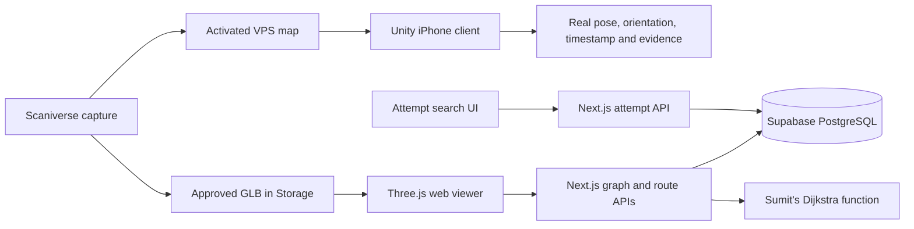

# 4. Architecture, Database and APIs

**Author:** Noah Bran, Backend Lead

**Reviewers:** Daksh Kumar and Ezeren Masangcay

**Status:** M2 draft; local SQL/API checks and a Webpack production build passed. Shared M2 schema application and integration remain pending.

## 4.1 System architecture and M2 boundary

SpatialOS provides a shared representation of one scanned indoor area and its navigation paths, together with records of localization tests. M2 demonstrates the core spatial pieces: the scanned model, a manually entered graph, a manually selected start and destination, one computed route, a real VPS-localized iPhone position, and a database-backed list/search prototype.

The web application retains the team's Next.js App Router, React, TypeScript and Tailwind foundation. Next.js route handlers run on Node.js 22 through Vercel. Supabase PostgreSQL 17 stores structured data. Supabase Storage is the planned location for the approved Scaniverse GLB. The Unity iPhone client uses the Niantic Spatial SDK for VPS localization and is built separately from the web application.

The two scan outputs serve different purposes: the visual model is rendered in the browser, while the VPS map supports phone localization. Neither automatically supplies a walkable graph. The graph is entered and checked manually. M2 manual routing is independent of the real-phone localization gate; a successful manual route or seeded attempt does not demonstrate VPS localization.

M2 Team Plan v2 supersedes M1's Android proposal and earlier responsibility schedule. Sumit is primary for the iPhone build and VPS test, with Daksh as backup; Daksh leads scanning and VPS activation. Noah supplies schema, seed template, graph/search APIs, routing integration and this section. Ezeren owns model alignment in the viewer, graph/route rendering and deployment; Calvin owns UI flows and styling; Tyler prepares seed records and runs the checklist.

Shared closures, automatic rerouting, robot simulation, health metrics/dashboard, Gemini explanations, live-start snapping and broader telemetry ingestion remain M3-M4 implementation work. Sumit's separate M2 live-position work adds `pose_samples` for the iPhone demo; it is not a general telemetry pipeline. Human/robot graph attributes are defined now so the routing interface remains compatible. They do not constitute robot simulation.

## 4.2 Spatial frame and data flow

All graph positions use `{x_m,y_m,z_m}` in a named right-handed, Y-up world frame. X/Z are the horizontal plane. Distances are meters; attempt latency is milliseconds; timestamps are UTC. The approved model defines the world frame after its scale, axes and origin are verified. Nodes are points on that model. The exact origin and positive horizontal directions must be recorded for the real map; the included seed frame is explicitly synthetic.

Segments contain a start node, end node, ordered polyline geometry, distance, direction, open/closed state and robot-access rule. Geometry runs start to end even when the edge is bidirectional. The backend checks that its endpoints match the nodes and its length agrees with `distance_m` within 0.01 m. Human routes use open segments; robot-profile routes use open, allowed segments. Reopening preserves robot access.

VPS poses require a documented source-to-world transform; provider and Unity coordinates must not be assumed identical to viewer coordinates. M2 records the transform in reviewed configuration and validates it at at least three known points. Sumit, Daksh and Ezeren must agree on source axes, scale and orientation handling. Sumit's separate live-position branch currently negates Unity Z for position; that is an implementation assumption, not a verified site alignment. The backend foundation supplies no fabricated transform or real asset URL. Sumit's `pose_samples` table now stores live samples separately; later transform, asset and session records remain outside this schema.

## 4.3 Database design

The additive migration is [202610110001_m2_foundation.sql](../../app/backend/migrations/202610110001_m2_foundation.sql). The existing M0 `users` and `team_members` schema remains unchanged.

| Table | Purpose and principal relationships |
|---|---|
| `sites` | Physical area, test-data flag, explicit public-demo opt-in and optional published active map belonging to that site |
| `map_versions` | Site-owned version, publication state, world frame, VPS identity/status and current graph/path-state revisions |
| `graph_nodes` | Versioned waypoints with labels and world positions |
| `path_segments` | Connections whose endpoints belong to the same map and graph revision; geometry and traversal rules |
| `destinations` | Named, active destinations attached to a node in the same site/map/revision |
| `test_points` | Evaluation or alignment points, optional independent reference measurement, verification and synthetic flags |
| `localization_attempts` | Unique trial records, map/point, pseudonymous device, mode/origin, condition, direction, timing and outcome |

UUID primary keys identify records. Composite foreign keys enforce map and revision consistency rather than relying only on API code. Checks reject unsupported enum values, empty labels, nonfinite or malformed positions, self-edges, invalid distances, inconsistent attempt timing and unlabeled failures. Referenced records cannot be cascade-deleted. Indexes support map/revision reads, endpoint lookups and point/outcome/time filtering.

`destinations.graph_revision` and `sites.is_public_demo` are explicit additions to Section 1 for integrity and public visibility. Reserved asset/session/valid-pose references in `localization_attempts` remain null in M2. Sumit's separate `pose_samples` table does not populate them. Measured horizontal error stays null and `error_is_valid` false until verified pose/reference ingestion exists. No dangling foreign IDs or invented measurements are accepted.

Synthetic seed attempts use `mode=simulation`, `data_origin=synthetic`, no SDK version, and no valid measured error. A success row requires a finished attempt within 30 seconds and a nonnegative latency no greater than the elapsed time. Failures retain a reason and no success latency. A timeout requires at least 30 seconds. The seed contains one site/map, eight nodes, ten edges, three destinations, five test points and ten attempts, matching the M2 target counts.

## 4.4 Access control and credentials

All seven tables have row-level security. A maintainer must explicitly opt a site into public demo visibility and publish its map before the graph is readable. Only current-revision nodes/segments, active destinations, and synthetic test points/attempts are available to public callers. Draft/private maps and real trial records remain hidden.

Both `anon` and `authenticated` roles have SELECT permission only. A login does not grant M2 writes or access to private trials. There are no public insert/update/delete policies or write endpoints. Existing M0 tables and policies are not changed. The later role/site-membership model remains designed rather than implemented.

The Next.js M2 database client uses only the publishable/anon key and does not forward user sessions or use a service-role key. It rejects accidentally configured secret/service-role credentials. Privileged maintenance stays in reviewed administrative workflows. Raw database error details are not sent to clients. No credentials or raw camera recordings are stored in the repository.

## 4.5 APIs and teammate integration

The complete request/response specification is [CONTRACTS.md](CONTRACTS.md), with shared [TypeScript wire types](../../app/frontend/lib/spatial/contracts.ts).

| Endpoint | M2 behavior | Implementation status |
|---|---|---|
| `GET /api/graph?map_version_id=<uuid>` | Returns site/frame/revisions, nodes, segments, active destinations and synthetic point options from one database snapshot | Verified through local Next.js against shared Supabase; deployment pending |
| `GET /api/localization-attempts?map_version_id=<uuid>` | Lists synthetic attempts; AND filters by point/outcome and optional point-label substring; bounded pagination and total count | Verified through local Next.js against shared Supabase; frontend/deployment integration pending |
| `POST /api/route` | Validates map, manual start, destination and profile; calls Sumit's routing function and checks returned traversal | Verified through local Next.js against shared Supabase; deployment pending |

Graph fields match Ezeren's viewer conventions, including ordered geometry and explicit `from_node_id`/`to_node_id` route steps. UUIDs replace temporary `N1` and `D1` identifiers; those can remain human-readable labels. Model URLs remain separate reviewed configuration.

The routing function accepts the database graph snapshot, start/end node IDs and human/robot profile. A valid route returns ordered steps and total distance. An unreachable result returns empty steps and null distance; a start already at its destination returns an empty valid path with distance zero. Routes are not stored in M2. Responses carry the graph and path-state revisions used.

Sumit's pure Dijkstra function and tests were copied from `origin/feature/r5-routing` (`ab1db5c`) without merging that branch. The adapter calls it on one database graph snapshot and checks the returned traversal. Local API tests verify the seeded human, robot, unreachable and zero-distance routes; Sumit's own 13 tests pass. The human, robot and unreachable routes also passed through local Next.js against the shared Supabase graph. The deployed viewer has not yet been verified.

Input validation rejects malformed IDs, unknown filters, invalid profile values and oversized/invalid JSON. Missing or private entities return 404 without revealing private existence. Search with no matches returns HTTP 200 with empty `items` and `total: 0`. Database failures return a sanitized 503. Responses disable caching so refreshes can reflect reviewed database edits. Each database request has a five-second timeout.

## 4.6 Validation, evidence and remaining work

[Validation evidence](evidence/local-validation.md) distinguishes local SQL and API tests, shared Supabase application, and pending deployed-system verification. SQL tests exercise cross-map/revision constraints, geometry, timing, sample counts and anonymous/authenticated access controls. API tests exercise filtering, pagination, validation, empty results, error sanitization and routing.

The fixture's hand-calculated route from N1 to Room 103 is 8 m for a human and 16 m for a robot; the East room is unreachable while S9 is closed. The integrated function passes these local checks. Tyler's [seed guide](SEED_GUIDE.md) lists exact search counts and UUIDs.

The reviewed migration and synthetic seed were applied to Supabase on October 13, 2026; the sample graph and three API behaviors were verified through local Next.js. Sumit's later `pose_samples` migration and HSS 349 placeholder seed are on `origin/feature/sumit-live-position` and already in shared Supabase; they must be preserved when branches are integrated. PR #34 generated an automatic Vercel preview, but production and viewer acceptance checks remain pending. Remaining work includes agreeing the real model/frame, connecting the viewer and search UI, and running the Vercel checklist. The iPhone VPS gate requires a real position, orientation and timestamp plus screenshot/video. Tyler runs the final checklist and Sumit signs off; backend tests cannot replace those acceptance checks.
