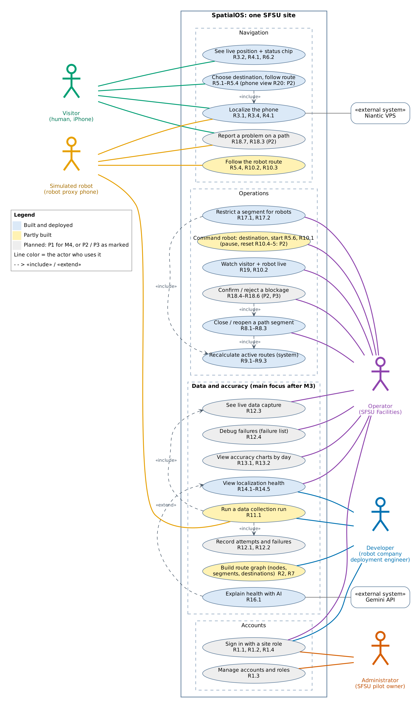
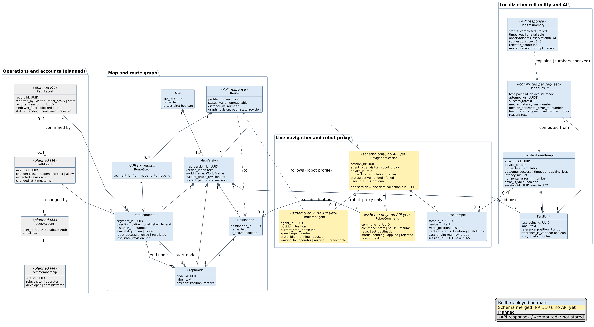
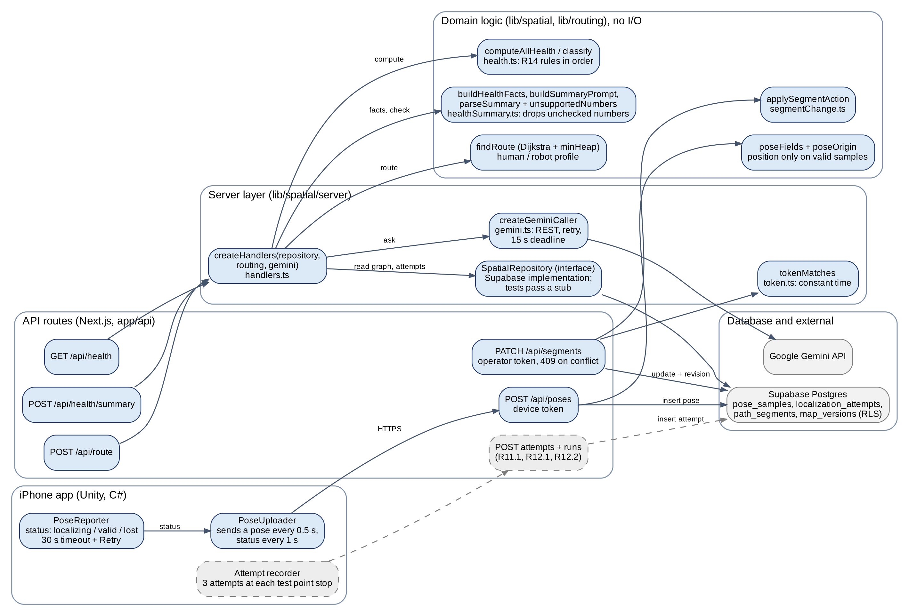
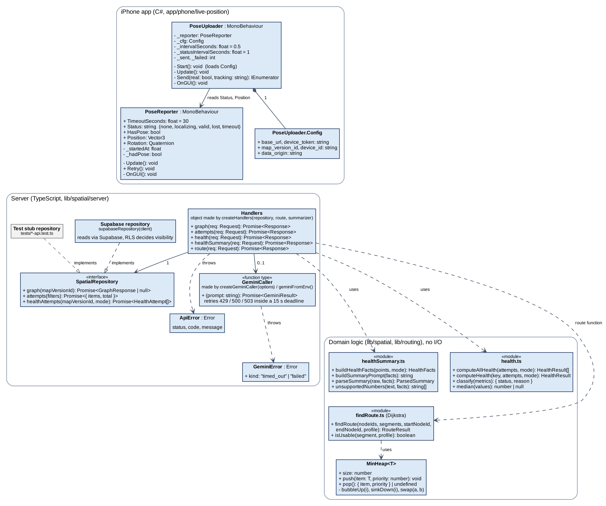
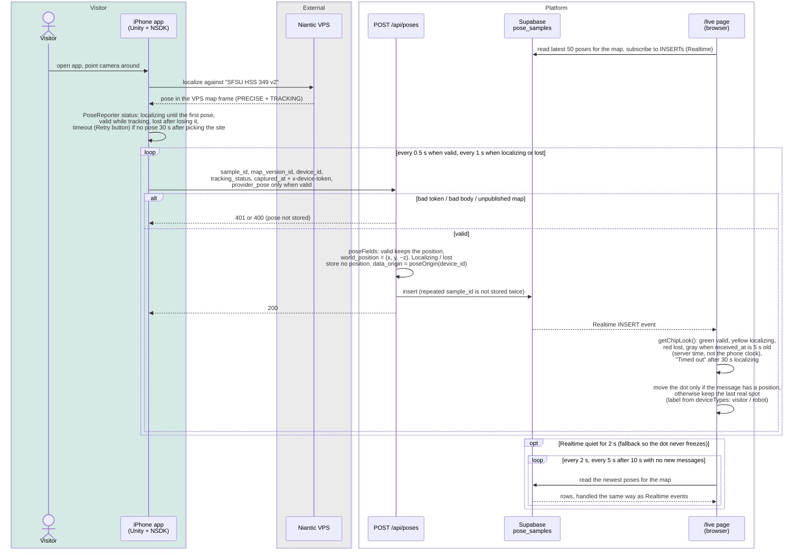
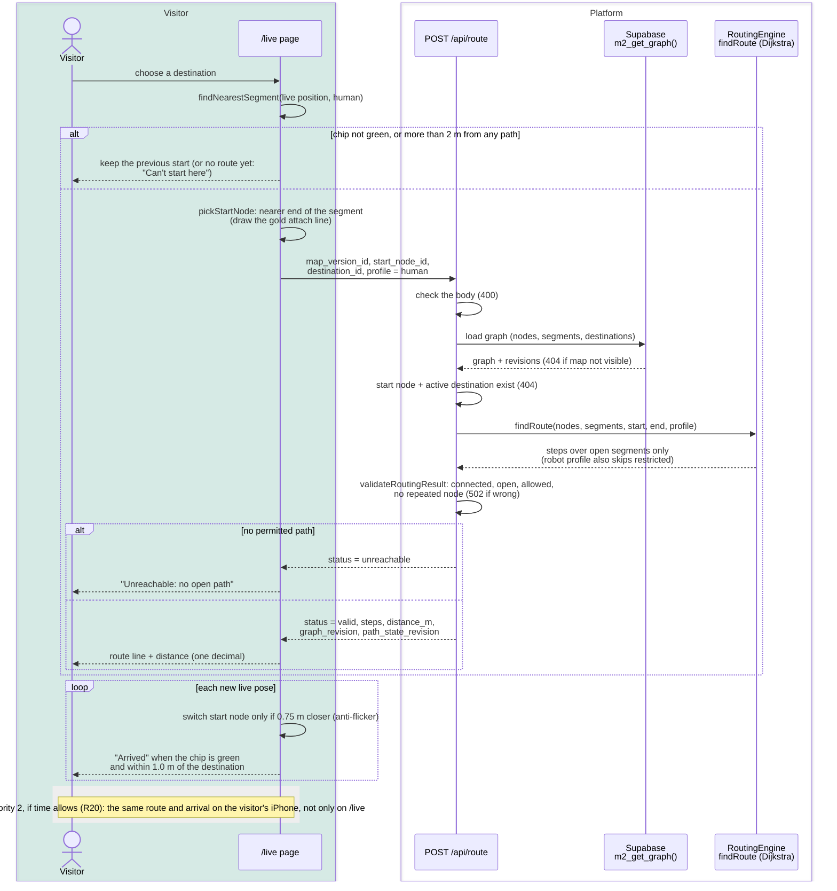
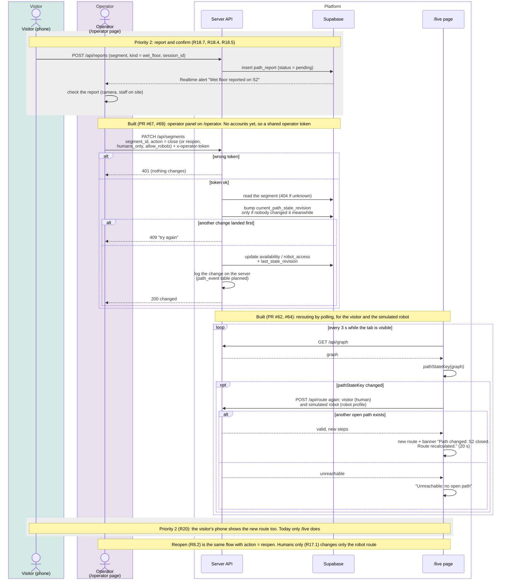
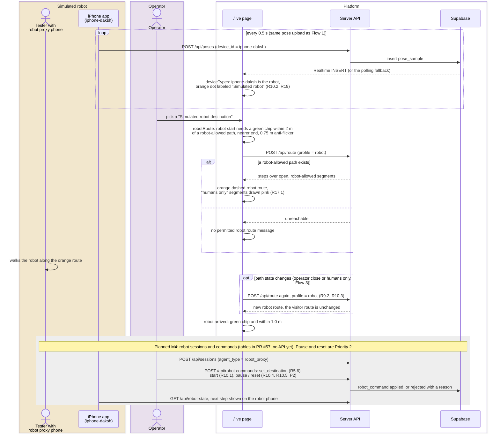
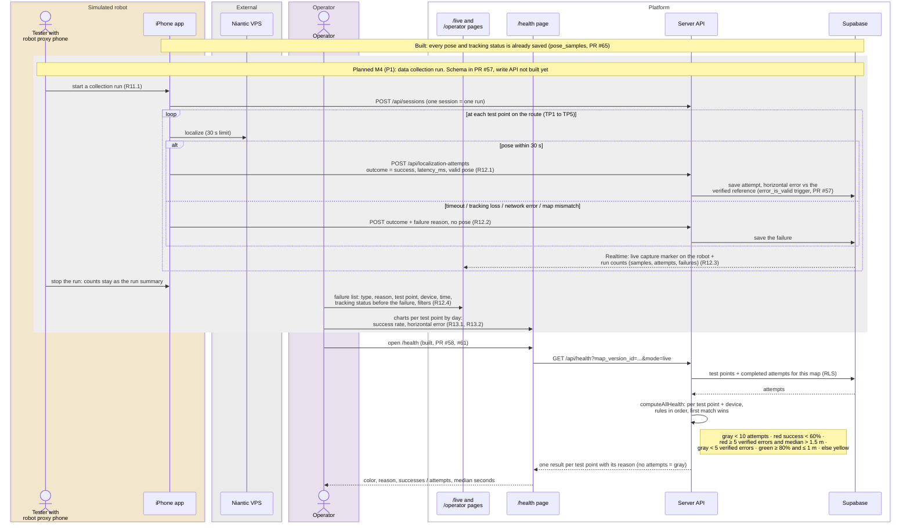
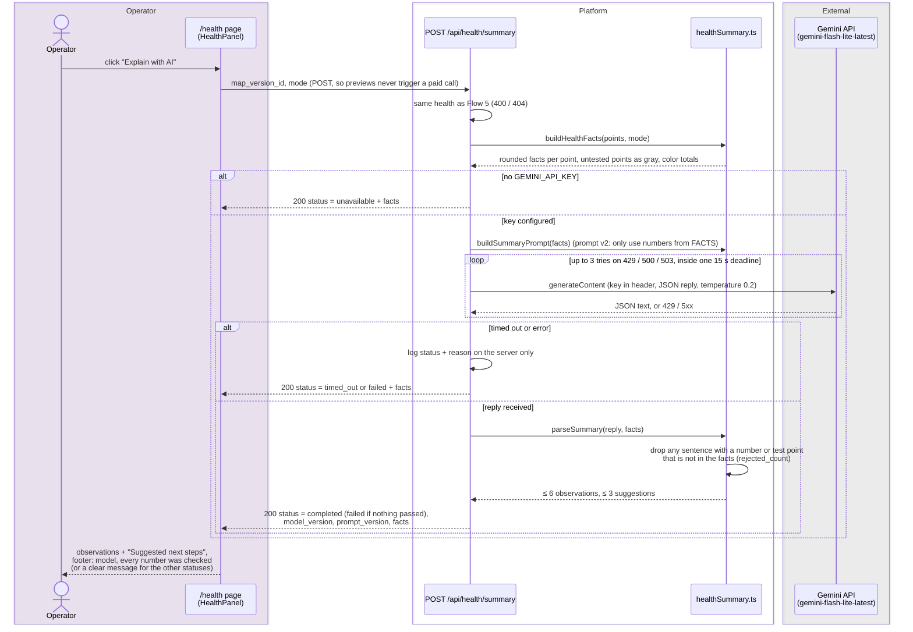

# M3 UML (Appendix I, item 3)

Diagram sources for the M3 UML: one use case diagram, two class diagrams (I.2 domain classes, I.10 implementation classes), six sequence diagrams and one implementation component diagram (I.9). Updated Nov 4, 2026 to match main (PR #57, #62, #64, #65, #67, #69) and the frozen Priority 1 list. After the M3 review the main point is data and localization accuracy, so Flow 5 is the data collection run and navigation items moved to Priority 2 are marked P2.

| Figure | Source | Tool |
|---|---|---|
| I.1 Use cases | `fig1_use_cases.dot` (uses the `stick_*.png` actor icons) | Graphviz |
| I.2 Classes | `fig2_classes.puml` | PlantUML |
| I.3 to I.8 Sequences | `fig3_...mmd` to `fig8_...mmd` | Mermaid (rendered below) |
| I.9 Implementation components | `fig9_implementation_components.dot` | Graphviz |
| I.10 Implementation classes | `fig10_implementation_classes.dot` | Graphviz |

Colors: blue = built and deployed, yellow = partly built, gray = planned (P1 for M4, or P2 / P3 as marked). Actors: visitor green, simulated robot orange, operator purple, developer blue, administrator red-orange, external systems gray. The outlined "Platform" band is our pages, server and database.

## Re-render

```bash
cd milestones/M3/uml
dot -Tpng -Gdpi=200 fig1_use_cases.dot -o fig1_use_cases.png
plantuml -tpng -Sdpi=192 fig2_classes.puml
dot -Tpng -Gdpi=220 fig9_implementation_components.dot -o fig9_implementation_components.png
dot -Tpng -Gdpi=200 fig10_implementation_classes.dot -o fig10_implementation_classes.png
for f in fig[3-8]_*.mmd; do npx -y @mermaid-js/mermaid-cli -c mermaid.json -s 2 -b white -i "$f" -o "${f%.mmd}.png"; done
```

## Use case and domain class diagrams





## Implementation components and classes





## Sequence diagrams

### Flow 1: Localize the phone and show the live position



### Flow 2: Choose a destination and follow the route



### Flow 3: Wet floor: report, close, and reroute everyone



### Flow 4: Run the simulated robot with the robot proxy phone



### Flow 5: Data collection run: capture, failures and accuracy



### Flow 6: Explain localization health with AI


