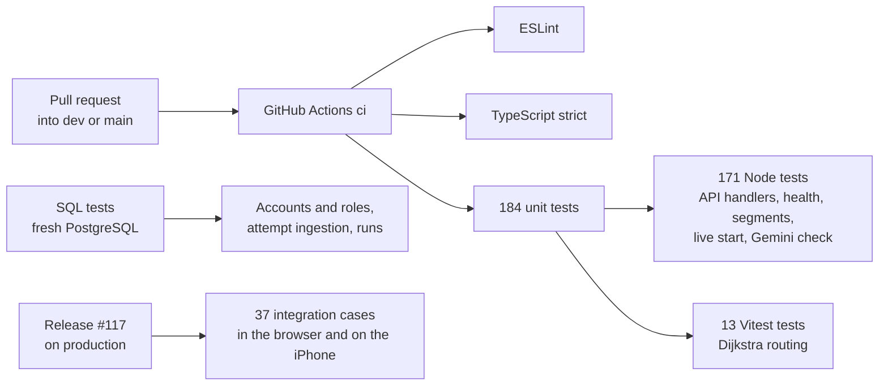

# Milestone 4: QA Testing and Coding Practices

**SpatialOS** · SW Engineering CSC 648/848 · Section 06, Team 02 · Submitted November 22, 2026

| Item | Link |
|---|---|
| **Submitted document** | [CSC648-848 Section 06 Milestone4 Team02.pdf](CSC648-848%20Section%2006%20Milestone4%20Team02.pdf) ([.docx](CSC648-848%20Section%2006%20Milestone4%20Team02.docx)) |
| **Production site** | <https://sfsu-csc648-06-fall26-team02.vercel.app> (release #117, `main` at `9d76b3f`) |
| **Generated API docs** | <https://sfsu-csc648-06-fall26-team02.vercel.app/api-docs/index.html> |
| **Bug tracker** | [GitHub Issues, label `bug`](https://github.com/ezerenm/SFSU-csc648-06-Fall26-team02/issues?q=is%3Aissue%20label%3Abug) |
| **Unit tests** | [`app/frontend/tests/`](../../app/frontend/tests) and [`lib/routing/findRoute.test.ts`](../../app/frontend/lib/routing/findRoute.test.ts) |
| **CI workflow** | [`.github/workflows/ci.yml`](../../.github/workflows/ci.yml) |
| **Previous milestone** | [Milestone 3](../M3) |
| **Next milestone** | [Milestone 5](../M5) |

## Contents

| Path | What it is |
|---|---|
| [`CSC648-848 Section 06 Milestone4 Team02.pdf`](CSC648-848%20Section%2006%20Milestone4%20Team02.pdf) | **Submitted M4 document.** Section 1: unit tests for 10 P1 features, coverage, CI, 38 integration test cases, bug tracker. Section 2: coding style and generated documentation. |
| This README | Results summary and what M4 added to the product |
| [`BACKEND_HANDOFF.md`](BACKEND_HANDOFF.md) | Backend handoff (Noah Bran): accounts and site roles, live attempt ingestion, collection runs, rollout status, SQL tests |

## Results

All numbers are from release #117 (`main` at `9d76b3f`), November 22, 2026.

| Measure | Target (M4 brief) | Result |
|---|---|---|
| Unit tests for P1 features | 10 features | **10 features**, 184 tests passing (171 Node test runner, 13 Vitest) |
| Function coverage | 90% or more | **93.85%** |
| Statement coverage | Over 50% | **92.67%** (1,113 of 1,201, Istanbul) |
| Line and branch coverage | | 95.55% lines, 89.01% branches |
| CI on pull requests (extra credit) | Optional | **Done:** lint, typecheck and all tests on every PR into `dev` or `main` |
| Integration tests | 85% of P1 features | 38 cases, 37 run, **0 failures**; **48 of 51 P1 features (94.1%)** exercised: 42 full, 6 partial |
| Bugs | Logged, assigned, resolved | **21 logged and closed**, each linked to its fix commit |
| Coding style | Described and enforced | TypeScript-ESLint and Next.js rules (86 active rules), TypeScript strict, checked in CI |
| Source files following the style | 85% of P1 features | Files for **45 of 51 P1 features (88%)** listed |
| Generated documentation (extra credit) | Optional | **Done:** TypeDoc HTML, 64 of 75 public functions documented (85.3%), rebuilt on every deploy |

### Testing at a glance

## Unit-tested P1 features

| # | P1 feature | Main units | Test files |
|---|---|---|---|
| 1 | R5.2 Shortest route for a person | `findRoute`, `MinHeap`, `server/routing` | `findRoute.test.ts`, `spatial-api.test.ts` |
| 2 | R5.4 Robot route on robot-allowed segments | `findRoute` (robot profile), `robotRoute` | `findRoute.test.ts`, `robot-route.test.ts` |
| 3 | R6.2.2, R6.3 Live start on the nearest open segment, reject over 2 m | `segmentAttach` | `segment-attach.test.ts` |
| 4 | R4.1, R4.2 Tracking state, stale after 5 s | `trackingStatus`, `livePhones`, `poseFields` | `tracking-status`, `live-phones`, `pose-fields` |
| 5 | R8.1, R8.2, R17.1, R17.2 Operator segment changes | `segmentChange` | `segment-change.test.ts` |
| 6 | R9.1, R9.3 Reroute after a change, Unreachable | `pathState`, `liveRoute` | `path-state`, `live-route` |
| 7 | R12.3 Capture indicator | `captureStatus` | `capture-status.test.ts` |
| 8 | R14.1 to R14.5 Localization health | `health`, `server/handlers` | `health.test.ts`, `health-api.test.ts` |
| 9 | R15.1 Attempt list and search | `attemptQuery`, `server/validation`, `server/repository` | `attempt-query`, `spatial-api.test.ts` |
| 10 | R16.1 Gemini summary with every number checked | `healthSummary`, `server/gemini` | `health-summary`, `gemini`, `health-summary-api` |

Gemini and Supabase are never called for real in unit tests; the tests use fixtures, a fake fetch and a fake Gemini caller.

## P1 integration coverage

| Result | P1 features | Count |
|---|---|---|
| Passed | R1.1 to R1.4, R2.1 to R2.4, R3.2 to R3.4, R4.1, R4.2, R5.1 to R5.4, R6.1, R6.2.1, R6.2.2, R6.3, R6.4, R8.1 to R8.3, R9.1 to R9.3, R10.2, R10.3, R12.3, R14.1 to R14.5, R15.1, R15.3, R16.1, R17.1, R17.2, R19 | 42 |
| Passed, partial | R10.1 (robot recognized by device ID, no mode switch in the app yet); R11.1, R12.1, R12.2 (database tests only); R12.4 (API only, no operator page yet); R5.6 (robot destination picked on `/live`, not yet sent as a command) | 6 |
| Not tested | R3.1 (needs both phones in HSS 349, planned for the Dec 1 class); R13.1, R13.2 (charts not built yet) | 3 |

The partial and untested items are carried into the [M5 plan](../M5).

## What M4 added

| PR | What | Requirements |
|---|---|---|
| #75 | HSS 349 v3 scan: graph nodes and test points re-measured on the new map | R2.1 to R2.4 |
| #76 | CI workflow: lint, typecheck and tests on every pull request | Quality |
| #77 | Capture status on `/live` while data is collected | R12.3 |
| #78 | Release to production (Nov 10) | |
| #79 | Accounts and per-site roles, `/account` page, operator token replaced by sign-in; live attempt ingestion | R1.1 to R1.4, R12.1, R12.2 |
| #80 | Failure list API (`GET /api/failures`) | R12.4 |
| #81, #90 | Path changes and live layers on the 3D view without reloading | R8.3, R19 |
| #82 | Gaussian splat of the scan as the 3D view | R2.2 |
| #89 | Data collection runs (`/api/runs`, `/api/runs/counts`) | R11.1 |
| #103 | Live map legend and dot color fixes | R19 |
| #107, #115, #116 | `npm run test:coverage`, TypeDoc setup and doc comments, published at `/api-docs` | Documentation |
| #117 | Release to production (Nov 22): all of the above live, M4 migrations applied | |

## Pages and APIs added or changed in M4

| Page or API | Change |
|---|---|
| `/account` | New: sign up, sign in, sign out, your site roles, role manager for administrators |
| `/operator` | Now requires a signed-in operator or administrator; the shared operator token is gone |
| `/api-docs` | New: generated TypeDoc reference |
| `POST /api/localization-attempts` | New: live attempt from the phone (`x-device-token`), idempotent by attempt ID |
| `GET /api/failures` | New: failure list with an optional `failure_type` filter |
| `POST /api/runs`, `PATCH /api/runs` | New: start and stop a data collection run (Supabase access token) |
| `GET /api/runs/counts` | New: samples, attempts and failures in a run |
| `PATCH /api/segments` | Now verifies the user's access token and runs under that user's row level security |

Environment variable change: `OPERATOR_TOKEN` is no longer used.

## Backend changes

Three apply-once migrations were added in M4. All three were **applied to shared Supabase on Nov 22, 2026** and went live with release #117. Do not run them again.

| Area | What it does | Migration | Requirements |
|---|---|---|---|
| Accounts and site roles | One role per user and site (visitor, developer, operator, administrator), enforced by row level security; replaces the shared operator token | [`202611080001_m4_accounts_roles.sql`](../../app/backend/migrations/202611080001_m4_accounts_roles.sql) | R1.1 to R1.4 |
| Live attempt ingestion | Saves the phone's attempts, links the matching pose and measures the error in meters; safe to retry | [`202611100001_m4_attempt_ingestion.sql`](../../app/backend/migrations/202611100001_m4_attempt_ingestion.sql) | R12.1, R12.2 |
| Data collection runs | Start and stop a run; poses and attempts in its time window are linked to it | [`202611160001_m4_runs.sql`](../../app/backend/migrations/202611160001_m4_runs.sql) | R11.1 |

Each migration has a SQL test in [`app/backend/tests/`](../../app/backend/tests). Request fields, response codes, access rules and test details are in the **[M4 backend handoff](BACKEND_HANDOFF.md)** by Noah Bran.
