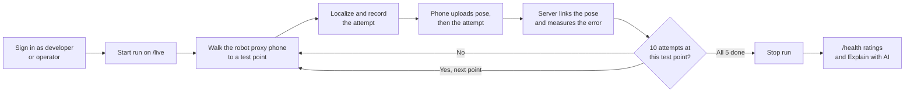
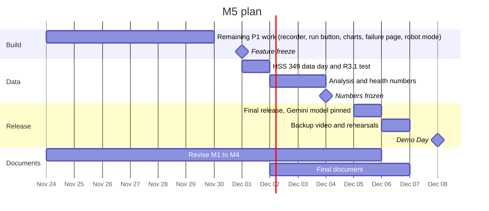

# Milestone 5: Final Delivery and Demo Day

**SpatialOS** · SW Engineering CSC 648/848 · Section 06, Team 02 · Demo Day December 8, 2026

> **Status: plan.** This README is the working plan for M5. Each section is updated as work lands, and the Results section is filled in after the Dec 1 data day.

| Item | Link |
|---|---|
| **Final document** | To be added |
| **Production site** | <https://sfsu-csc648-06-fall26-team02.vercel.app> (deployed from `main`) |
| **Demo Day** | Tuesday, December 8, 2026, 12 to 4 PM |
| **Previous milestone** | [Milestone 4](../M4) |

## Goals

1. **Real localization data.** Collect live attempts at all 5 HSS 349 test points, enough for every test point to get a real health rating instead of gray.
2. **Close the Priority 1 gaps** left after M4: 6 partial and 3 untested features.
3. **Final demo** that is clear, fast and works on the first try, with a recorded backup.
4. **Revised M1 to M4 documents** with the instructor feedback included, resubmitted with M5.

## Where M4 left off

| Priority 1 feature | State after M4 | What is left for M5 |
|---|---|---|
| R3.1 Both phones localize with Niantic VPS | Not tested | Run IT-22 with both iPhones in HSS 349 |
| R13.1, R13.2 Health charts | Not built | Charts of success rate, latency and error per test point |
| R12.1, R12.2 Live attempt logging | Database and API only | The phone records each attempt and sends it to `POST /api/localization-attempts` |
| R11.1 Data collection runs | Database and API only | The `/live` Start run button calls `/api/runs` and keeps the returned `run_id` |
| R12.4 Failure list | API only | Operator page that lists failures with type, reason and test point |
| R10.1 Robot mode | Recognized by device ID | Robot mode switch in the phone app |
| R5.6 Robot destination | Picked on `/live` only | Send the destination to the robot phone as a command |

## Data collection plan

The health rules (Data Definitions 1.14) need at least **10 completed attempts** and at least **5 verified accuracy samples** per test point before a test point can be rated green, yellow or red. The plan is built around that minimum.

| Item | Plan |
|---|---|
| Where | HSS 349, map `HSS349-v3` |
| When | Dec 1 class (the last class before Demo Day) |
| Test points | TP1 to TP5 |
| Target | 10 or more attempts per test point, 50 or more in total |
| Recorded per attempt | Outcome, failure reason, latency, measured horizontal error, lighting and camera direction |
| Fallback | If the phone recorder is not ready, a paper run sheet imported after class, labeled as manually recorded |

## Timeline

| Date | What |
|---|---|
| Nov 24 to 30 | Finish the remaining P1 work; merge to `dev` with CI green |
| Tue Dec 1 | Last class: HSS 349 data day, R3.1 test, demo rehearsal, feature freeze |
| Fri Dec 4 | Analysis done, health numbers frozen |
| Sat Dec 5 | Final release to `main`; Gemini model pinned so the demo does not change |
| Dec 6 to 7 | Backup video, rehearsals, final document |
| Tue Dec 8 | Demo Day, 12 to 4 PM |

## Demo plan

A short walkthrough of about five minutes, the same order every time:

| Step | Page | What the audience sees |
|---|---|---|
| 1 | `/viewer` | The scanned room in 3D with the route graph and destinations |
| 2 | iPhone app and `/live` | The phone localizes with Niantic VPS; its dot and status appear live |
| 3 | `/live` | A person route and the simulated robot route on their own permitted paths |
| 4 | `/operator` | Close a segment or set it to humans only; both routes are recalculated live |
| 5 | `/health` | Real health ratings per test point from the Dec 1 data, then Explain with AI |

Before the demo:

- [ ] All path segments reopened and set back to allow robots
- [ ] Demo accounts signed in (operator on the laptop)
- [ ] Phone app built against production, `DEVICE_TOKEN` current
- [ ] Backup video of a full successful run, labeled as recorded
- [ ] Localization tested in the demo room on the day before

## Results

To be filled in after the Dec 1 data day.

| Test point | Attempts | Success rate | Median latency | Median error | Health |
|---|---|---|---|---|---|
| TP1 | | | | | |
| TP2 | | | | | |
| TP3 | | | | | |
| TP4 | | | | | |
| TP5 | | | | | |

| Measure | Result |
|---|---|
| Priority 1 features complete | |
| Unit tests and coverage on the final release | |
| Integration cases passed | |

## Revised milestone documents

| Milestone | Feedback to include | Status |
|---|---|---|
| [M1](../M1) | Instructor feedback of Oct 8 and Oct 26: iPhone platform, atomized requirements, grounded personas, robot proxy phone | To do |
| [M2](../M2) | 25 comments of Oct 24 and Oct 26: subject on every requirement, SFSU pilot scenario, merged UX flows | To do |
| [M3](../M3) | Final Priority 1 status | To do |
| [M4](../M4) | R3.1 and partial features retested on the final release | To do |
